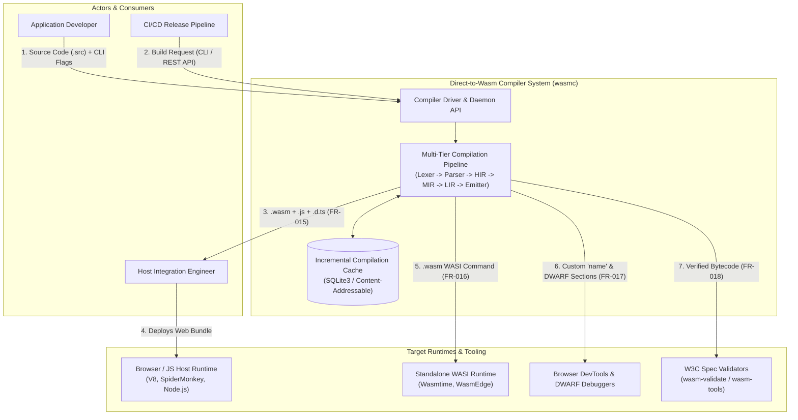
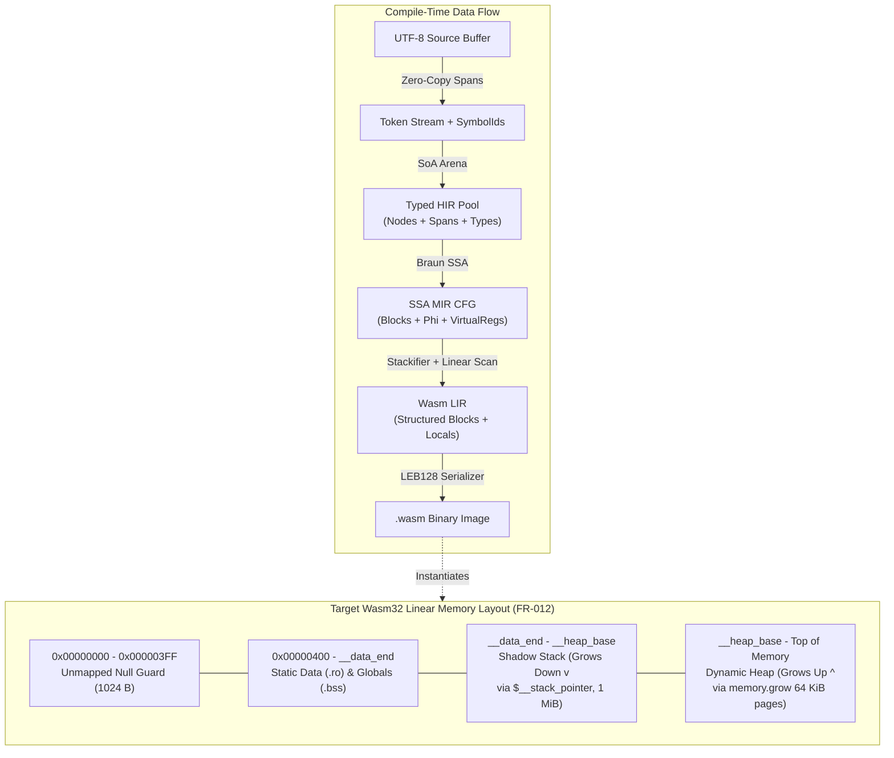
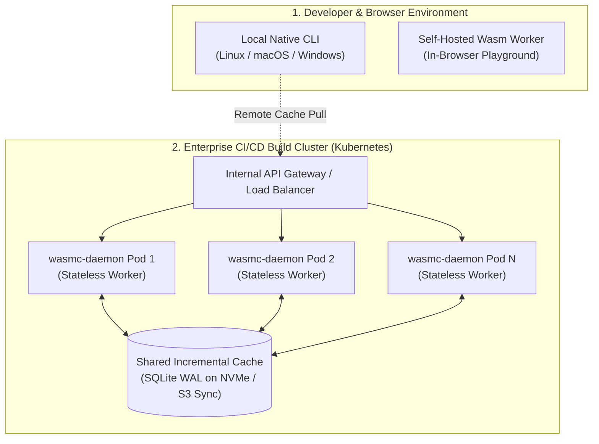

# High-Level Design (HLD): Direct-to-WebAssembly Compiler (`wasmc`)

**Document ID:** HLD-WASMC-2026-001  
**Version:** 1.0.0  
**Date:** October 14, 2026  
**Author:** Senior Software Architect  
**Source Documents:** `wasm_compiler_srs.md` (v1.0.0), `wasm_compiler_frd.md` (v1.0.0)  

---

## Table of Contents

1. [Document Overview](#1-document-overview)
2. [System Context and Architecture Overview](#2-system-context-and-architecture-overview)
3. [Major Components and Responsibilities](#3-major-components-and-responsibilities)
4. [Technology Stack and Justification](#4-technology-stack-and-justification)
5. [Data Architecture](#5-data-architecture)
6. [Integration Points and External Interfaces](#6-integration-points-and-external-interfaces)
7. [Deployment Architecture](#7-deployment-architecture)
8. [Non-Functional Requirements (NFR) Mapping](#8-non-functional-requirements-nfr-mapping)
9. [Key Architectural Decisions and Trade-Offs](#9-key-architectural-decisions-and-trade-offs)
10. [Risks, Assumptions, and Open Questions](#10-risks-assumptions-and-open-questions)
11. [HLD Requirement Traceability Matrix](#11-hld-requirement-traceability-matrix)

---

## 1. Document Overview

### 1.1 Purpose
This High-Level Design (HLD) defines the macro-level architecture, component boundaries, data topology, integration contracts, and deployment models for the custom Direct-to-WebAssembly Compiler (`wasmc`).

### 1.2 Scope
* **In Scope:** End-to-end compilation pipeline from UTF-8 source files to WebAssembly Core 1.0/2.0 binary modules (`.wasm`), optional WebAssembly Text (`.wat`), JavaScript/TypeScript host glue bindings (`wasm32-unknown-web`), WASI Preview 1/2 executables (`wasm32-wasi`), embedded runtime allocators (TLSF and Mark-and-Sweep GC), and an incremental compilation cache service.
* **Out of Scope:** Third-party backend frameworks (LLVM/Binaryen prohibited per `SYS-ARCH-001` / `BR-001`), IDE UI extensions, and custom Wasm virtual machines.

### 1.3 Intended Audience
* Systems Architects and Compiler Engineers
* Frontend/Host Integration Engineers and DevOps Engineers
* Quality Assurance (QA) Leads and Security Auditors

---

## 2. System Context and Architecture Overview

### 2.1 System Context Diagram
`wasmc` operates both as a standalone Command-Line Interface (CLI) executable and as a stateless/cached compilation daemon accessible via HTTP/JSON-RPC for CI/CD pipelines and browser playgrounds.

### 2.2 Architecture Pattern
The system uses a **Deterministic Multi-Tier Pipeline Architecture** backed by **Data-Oriented Design (DOD)** memory arenas (`SYS-ARCH-002`):
1. **Zero-Pointer Arena Pools:** All AST nodes, IR instructions, and symbol entries are stored in contiguous vectors indexed by 32-bit integers (`u32`) rather than heap-allocated pointer graphs.
2. **Three-Tier Intermediate Representation:** Separates syntactic desugaring (**HIR**), machine-independent SSA optimizations (**MIR**), and WebAssembly stack scheduling (**LIR**).

---

## 3. Major Components and Responsibilities

```mermaid
flowchart LR
    subgraph FrontEnd ["Front-End Subsystem"]
        M_LEX["MOD-LEX\nDFA Lexer & Interner"]
        M_PAR["MOD-PAR\nRD + Pratt Parser"]
        M_SEM["MOD-SEM\nBidirectional Typechecker"]
    end

    subgraph MiddleEnd ["Middle-End Subsystem"]
        M_HIR["MOD-HIR\nDesugar & Monomorphizer"]
        M_MIR["MOD-MIR\nSSA CFG Builder"]
        M_OPT["MOD-OPT\nMIR Optimizer"]
    end

    subgraph BackEnd ["Back-End Subsystem"]
        M_SCF["MOD-SCF\nStackifier Engine"]
        M_STK["MOD-STK\nStack & Local Allocator"]
        M_MEM["MOD-MEM\nLinear Memory & Allocator"]
        M_BIN["MOD-BIN\nLEB128 Binary Emitter"]
        M_BND["MOD-BND\nJS/TS & WASI Glue Gen"]
    end

    M_LEX --> M_PAR --> M_SEM --> M_HIR --> M_MIR --> M_OPT --> M_SCF --> M_STK --> M_MEM --> M_BIN --> M_BND
```

| Module ID | Component Name | Primary Responsibilities | SRS / FRD Mapping |
| :--- | :--- | :--- | :--- |
| `MOD-DRV` | **Compiler Driver & Daemon** | Parses CLI arguments and REST/RPC payloads, manages immutable source file buffers, queries the incremental cache, and orchestrates pipeline threads. | `SYS-ARCH-001`, `FR-018` |
| `MOD-LEX` | **DFA Lexer & String Interner** | Scans UTF-8 byte buffers using a zero-allocation DFA; emits byte-span tokens `(start: u32, len: u32)`; interns identifiers into 32-bit `SymbolId` handles; recovers from lexical faults at whitespace/newlines. | `FE-LEX-001`..`005`, `FR-001`, `FR-002` |
| `MOD-PAR` | **Hybrid Syntax Parser** | Parses declarations/statements via Recursive Descent and expressions via Pratt operator precedence ($BP_L, BP_R$); synchronizes on panic tokens (`;`, `}`, `fn`, `let`, `return`); injects `PoisonExpr`/`ErrorStmt` nodes into the Struct-of-Arrays AST pool. | `FE-PAR-001`..`003`, `FE-AST-001`..`002`, `FR-003`, `FR-004` |
| `MOD-SEM` | **Semantic & Escape Analyzer** | Maintains a cactus-stack symbol table; executes bidirectional type checking ($\Gamma \vdash e \Rightarrow \tau$ and $\Gamma \vdash e \Leftarrow \tau$); propagates `PoisonType`; enforces explicit `CastExpr` between 32/64-bit types; marks `&x` variables as `EscapedToLinearMemory`. | `FE-SEM-001`..`004`, `FR-005`, `FR-006`, `BR-002`, `BR-003` |
| `MOD-HIR` | **HIR Lowering & Monomorphizer** | Desugars `for` loops, compound assignments (`+=`), and short-circuiting booleans into canonical forms; monomorphizes generic functions/structs into concrete types. | `SRS Sec 4.1`, `FR-007` |
| `MOD-MIR` | **SSA MIR Builder** | Lowers Typed HIR into Three-Address Code basic blocks; constructs pruned Static Single Assignment (SSA) form via Braun et al.’s algorithm with $\phi$-nodes and explicit terminators (`Jump`, `Branch`, `Switch`, `Return`, `Trap`). | `IR-MIR-001`..`003`, `FR-007` |
| `MOD-OPT` | **Deterministic MIR Optimizer** | Executes `Mem2Reg` promotion, Constant Folding (IEEE 754 / two's complement), Algebraic Simplification ($x \times 2^n \rightarrow x \ll n$), Dominator-tree Value Numbering (CSE), Leaf Inlining ($N \le 25$), and Dead Code Elimination (DCE). | `IR-OPT-001`..`006`, `FR-008` |
| `MOD-SCF` | **Stackifier Control-Flow Engine** | Verifies CFG reducibility (splitting irreducible nodes); orders blocks in Reverse Post-Order (RPO) over the dominance tree; encloses backward branches in `loop ... end` and forward merges in `block ... end`; computes relative branch depths $d \in \mathbb{N}_0$. | `CG-SCF-001`..`002`, `FR-009`, `BR-004` |
| `MOD-STK` | **Stack Scheduler & Local Coalescer** | Elides locals for single-use intra-block expressions; fuses `local.set $x` + `local.get $x` into `local.tee $x`; performs Linear Scan Register Allocation with liveness coloring to minimize Wasm local declarations. | `CG-STK-001`..`003`, `FR-010` |
| `MOD-MEM` | **Memory Layout & Runtime Bundler** | Partitions `wasm32` linear memory (`0x0000` Guard, `0x0400` Static Data, downward Shadow Stack via `$__stack_pointer`, upward Heap at `__heap_base`); emits 16-byte aligned stack prologues/epilogues; links embedded TLSF or Mark-and-Sweep GC runtime. | `MM-LAY-001`..`004`, `MM-ABI-001`..`003`, `MM-ALC-001`, `FR-012`..`014`, `BR-006`, `BR-007` |
| `MOD-BIN` | **Wasm Binary & Debug Emitter** | Serializes `\0asm` v1 preamble, `uLEB128`/`sLEB128` integers, IEEE 754 floats, strict section ordering (`1..9, 12, 10, 11, 0`), saturating casts (`0xFC`), `@__wasm_panic` hooks, and Custom `"name"` / DWARF sections. | `CG-BIN-001`..`003`, `RT-TRP-001`..`004`, `FR-011`, `FR-017`, `BR-005`, `BR-008` |
| `MOD-BND` | **Host Binding Generator** | Generates ES6 `.js` and `.d.ts` wrappers with `TextEncoder`/`TextDecoder` string marshalling and `externref`/`HeapObjectTable` support for web targets; synthesizes `_start` and `wasi_snapshot_preview1` imports for WASI targets. | `RT-JS-001`..`003`, `RT-WASI-001`..`002`, `FR-015`, `FR-016` |

---

## 4. Technology Stack and Justification

| Layer / Concern | Selected Technology | Justification & Requirement Alignment |
| :--- | :--- | :--- |
| **Core Implementation Language** | **Rust (2024 Edition, `no_std` core compatible)** | Provides deterministic memory layout, zero-cost abstractions, pattern matching for IR passes, and native compilation to `wasm32` to satisfy self-hosting reproducibility (`NFR-PERF-003` / `FR-018`). |
| **Memory Allocation Pattern** | **Custom Bump Arenas & Index-Typed Vectors (`typed-arena` / SoA Arrays)** | Satisfies `SYS-ARCH-002` (`C-002`) by replacing 64-bit heap pointers with 32-bit indices (`NodeIndex`, `BlockId`, `RegId`), halving memory bandwidth and maximizing L1/L2 CPU cache hit rates to exceed $50,000\text{ LOC/sec}$ (`NFR-PERF-001`). |
| **Incremental Build Store** | **SQLite 3 (Embedded WAL Mode) + BLAKE3 Hashing** | Stores content-addressable AST/MIR hashes, symbol exports, and pre-compiled function bytecode blobs for sub-100ms incremental rebuilds without external DB servers. |
| **Daemon API Transport** | **Axum (HTTP/2 REST) + JSON-RPC 2.0 over stdio/UDS** | Exposes compilation, AST inspection, and diagnostic services to CI runners, remote build clusters, and IDE language servers. |
| **Verification & Fuzzing Suite** | **`wasm-tools` / WABT (`wasm-validate`), `libFuzzer` (`cargo-fuzz`), Wasmtime, V8** | Directly implements the Verification & Validation Matrix mandated in `SRS Sec 8.2` (`FR-018`). |

---

## 5. Data Architecture

### 5.1 High-Level Data Stores
1. **Immutable Source Buffer Pool (In-Memory):** Memory-mapped (`mmap`) or contiguous byte buffer holding raw UTF-8 source files. Tokens hold `(start_offset: u32, length: u32)` slices into this buffer (`FE-LEX-002`).
2. **Global String Interner (In-Memory Arena):** Deduplicates all identifiers and string literals using an open-addressed hash table backed by a contiguous byte arena, returning a 32-bit `SymbolId` (`FE-LEX-003`).
3. **Struct-of-Arrays (SoA) Compiler Arenas (In-Memory):** Separate contiguous arrays for `Vec<AstNode>`, `Vec`, and `Vec<TypeId>` indexed by `NodeIndex` so type-checking passes do not load source coordinate metadata into CPU cache lines (`FE-AST-001`, `FE-AST-002`).
4. **Incremental Compilation Cache (On-Disk SQLite):** Content-addressable database (`wasmc_cache.db`) persisting compiled function code bodies, monomorphized generic instances, and DWARF line tables keyed by BLAKE3 cryptographic hashes of the source AST and compiler flags.

### 5.2 High-Level Data Flow & Target Linear Memory Topology
During compilation, data transforms from source text to the target 32-bit linear memory layout (`MM-LAY-001`..`004`):

---

## 6. Integration Points and External Interfaces

| Interface Name | Direction | Protocol / Format | Description & Contract | Mapped Requirements |
| :--- | :--- | :--- | :--- | :--- |
| **CLI Interface** | Inbound | POSIX CLI Arguments & Exit Codes | Primary developer and CI entry point (`wasmc build <input> [flags]`). | `SRS Sec 7.1`, `FR-015`..`018` |
| **Compiler Daemon API** | Inbound | HTTP/2 JSON REST & JSON-RPC 2.0 | Allows build servers and IDEs to request compilation, diagnostics, and cache queries. | `FR-001`..`018` |
| **Web Host JS/TS ABI (`wasm32-unknown-web`)** | Outbound / Bidirectional | ES6 Module (`.js`), TypeScript (`.d.ts`), Wasm Exports/Imports | Exports `__alloc(len, align)`, `__dealloc(ptr, len)`, and `memory`; marshals UTF-8 strings via `TextEncoder`/`TextDecoder` and DOM handles via `externref` or `HeapObjectTable`. | `RT-JS-001`..`003`, `FR-015` |
| **WASI Host Interface (`wasm32-wasi`)** | Outbound / Bidirectional | `wasi_snapshot_preview1` Binary ABI | Exports `_start: () -> ()`; imports `fd_write`, `fd_read`, `clock_time_get`, `random_get`, and `proc_exit` using shadow-stack `ciovec` scatter/gather structs. | `RT-WASI-001`..`002`, `FR-016` |
| **Debugger & Profiler Interface** | Outbound | Wasm Custom Section (ID `0`) & Source Maps | Emits standard `"name"` subsection and DWARF (`.debug_info`, `.debug_line`, `.debug_abbrev`, `.debug_str`) for browser DevTools and standalone runtimes. | `CG-BIN-003`, `RT-TRP-004`, `FR-017` |

---

## 7. Deployment Architecture

### 7.1 Deployment Topologies
`wasmc` is deployed across three primary environments:
1. **Local Developer Workstation:** Single statically linked native binary (`wasmc` for Linux `x86_64`/`aarch64`, macOS Universal, Windows `x86_64`) with local SQLite cache in `~/.cache/wasmc/`.
2. **Self-Hosted Browser / Edge Sandbox:** Because `wasmc` has zero LLVM/C++ dependencies (`SYS-ARCH-001`) and deterministic memory behavior (`NFR-PERF-003`), the compiler itself compiles to a `< 2 MiB` `wasm32-wasi` module capable of running inside a browser Web Worker or Cloudflare Worker.
3. **CI/CD Distributed Build Cluster:** Containerized `wasmc-daemon` pods deployed on Kubernetes behind an internal gRPC/HTTP load balancer, sharing a distributed read-through object cache for incremental compilation artifacts.

### 7.2 Scalability Approach
* **Intra-Process Parallelism:** Lexical analysis, parsing, type checking, and MIR optimization run in parallel across functions/modules using a work-stealing thread pool, while final section serialization joins deterministically sorted by canonical `SymbolId` to preserve bit-for-bit reproducibility (`NFR-PERF-003`).
* **Horizontal Daemon Scaling:** `wasmc-daemon` nodes are stateless; compilation requests scale horizontally based on CPU utilization.

---

## 8. Non-Functional Requirements (NFR) Mapping

| NFR Category | Requirement ID | Target Metric / Constraint | Architectural Mechanism |
| :--- | :--- | :--- | :--- |
| **Performance (Throughput)** | `NFR-PERF-001`, `SYS-ARCH-002`, `FR-018` | $\ge 50,000\text{ LOC/sec}$ per single CPU core; sub-100ms turnaround. | Zero-copy DFA lexer (`FE-LEX-002`), SoA index pools (`FE-AST-001`..`002`), and zero-LLVM direct binary emission (`SYS-ARCH-001`). |
| **Footprint (Binary Size)** | `NFR-PERF-002`, `FR-018` | Minimal web "Hello World" `< 512 bytes`. | Aggressive Dead Code Elimination (`IR-OPT-005`), omission of empty Wasm sections (`CG-BIN-003` / `BR-005`), and `local.tee` / stackification (`CG-STK-001`..`002`). |
| **Reproducibility** | `NFR-PERF-003`, `FR-018` | 100% bit-for-bit identical `.wasm` SHA-256 across Linux, macOS, Windows, and Wasm hosts. | Forbidden use of randomized hash seeds (`SipHash` replaced with deterministic `FxHash`), software-emulated canonical IEEE 754 `NaN` bit patterns (`CG-BIN-002`), and deterministic RPO block sorting. |
| **Reliability & Safety** | `RT-TRP-001`..`003`, `MM-LAY-001`, `FR-017` | Zero compiler panics on malformed input; safe runtime traps on illegal operations. | Fuzz-tested panic-mode parser recovery (`FE-PAR-003`), $1024\text{-byte}$ unmapped null-pointer guard zone (`0x0000`–`0x03FF`), default saturating float casts (`0xFC`), and debug `@__wasm_panic` bounds/stack checks. |
| **Maintainability** | `SRS Sec 4.1`, `SRS Sec 8.2` | Strictly decoupled compiler passes; 100% `wasm-validate` compliance. | Well-defined intermediate representations (HIR, MIR, LIR) with automated IR verifier invariants between every pass. |

---

## 9. Key Architectural Decisions and Trade-Offs

| Decision ID | Architectural Decision | Rationale | Trade-Offs Accepted |
| :--- | :--- | :--- | :--- |
| **ADR-001** | **Zero-LLVM Custom Backend (`SYS-ARCH-001`)** | Eliminates a $>100\text{ MiB}$ binary dependency, C++ ABI mismatches, and slow multi-second compilation times. | Requires maintaining custom MIR optimization passes (`IR-OPT-001`..`006`) and a custom Stackifier (`CG-SCF-002`). |
| **ADR-002** | **Struct-of-Arrays (SoA) 32-Bit Index Arenas (`FE-AST-001`)** | Keeps `AstNode` size to $\le 16\text{ bytes}$ and strips `Span` data into a parallel array, doubling CPU cache density during semantic analysis. | Slightly more verbose indexing syntax (`ast.nodes[idx.0]`) compared to idiomatic pointer trees; limits a single compilation unit to $2^{32}-1$ AST nodes. |
| **ADR-003** | **Dominance-Based Stackifier over Relooper (`CG-SCF-002`)** | Produces clean, native Wasm `block`/`loop` structures without synthetic state variables or `br_table` dispatch loops. | Requires a pre-pass (`CG-SCF-001`) to detect and split irreducible CFG loops via node duplication before running the Stackifier. |
| **ADR-004** | **Downward Shadow Stack Below Upward Dynamic Heap (`MM-LAY-003`)** | Placing the shadow stack between `__data_end` and `__heap_base` growing downward toward `0x0400` allows the dynamic heap to grow upward indefinitely via `memory.grow` without relocating the stack. | Fixes maximum shadow stack capacity at compile time (default $1\text{ MiB}$); deep recursion requires `--debug` stack overflow checks (`RT-TRP-003`). |

---

## 10. Risks, Assumptions, and Open Questions

### 10.1 Technical Risks & Mitigations
| Risk ID | Description | Severity | Mitigation Strategy |
| :--- | :--- | :--- | :--- |
| **RSK-001** | **Irreducible Control Flow Path Explosion:** Node splitting (`CG-SCF-001`) on pathological irreducible CFGs can exponentially increase code size. | Medium | Restrict source language constructs to structured loops (`while`, `for`, `break`, `continue`) so MIR CFGs remain naturally reducible; cap node-splitting duplication factor before falling back to a local state variable dispatcher. |
| **RSK-002** | **Cross-Platform Float Folding Divergence:** Host CPU differences in x87/SSE/ARM64 `NaN` payloads could break `NFR-PERF-003` bit-for-bit reproducibility during Constant Folding (`IR-OPT-001`). | High | Implement constant folding using deterministic software bit-level IEEE 754 canonicalization (`0x7FC00000` for `f32`, `0x7FF8000000000000` for `f64`). |
| **RSK-003** | **Linear Memory Detachment During JS Marshalling:** Calling `__alloc` in `RT-JS-002` may trigger `memory.grow`, detaching the JavaScript `ArrayBuffer` reference. | High | Generated `.js` glue code must re-instantiate `new Uint8Array(wasmMemory.buffer, ...)` *after* every `__alloc` or Wasm function invocation. |

### 10.2 Assumptions
* **ASM-001:** Source files are UTF-8 encoded and fit within a 4 GiB (`u32`) byte offset window (`FE-LEX-002`).
* **ASM-002:** Target Wasm engines support the bulk-memory and non-trapping float-to-int (`0xFC`) opcodes standardized in WebAssembly 2.0 (`RT-TRP-002`).

### 10.3 Open Questions (Carried Forward from FRD Gap Analysis)
* **OQ-001 (`OI-001` - Formal Source Language EBNF Grammar):** What are the exact concrete keywords and operator tokens for generics and union declarations in `FE-PAR-001` and Section 4.1? *(LLD defines a canonical Rust-like grammar pending final sign-off).*
* **OQ-002 (`OI-002` - Runtime Memory Model Selection):** Should the switch between **Mode A** (TLSF Manual Allocator) and **Mode B** (Mark-and-Sweep GC) in `MM-ALC-001` be controlled strictly via CLI flag (`--memory-model=manual|gc`) or per-module pragma?
* **OQ-003 (`OI-003` - WAT Disassembly Emission Scope):** Is human-readable `.wat` emission (`SRS Sec 1.2`) required as a synchronous build artifact via `--emit-wat` in the MVP release?
* **OQ-004 (Multi-File Module Linking):** Does the MVP compiler ingest a single root module with `import` file inclusion, or must it output relocatable Wasm object files for a separate linker pass?

---

## 11. HLD Requirement Traceability Matrix

| SRS ID | FRD ID | Requirement Summary | HLD Component(s) | HLD Section(s) |
| :--- | :--- | :--- | :--- | :--- |
| `SYS-ARCH-001` | `BR-001`, `FR-018` | Zero-LLVM direct bytecode emission | `MOD-DRV`, `MOD-BIN` | Sec 1.2, 2.2, 4, 9 (`ADR-001`) |
| `SYS-ARCH-002` | `C-002`, `FR-018` | Arena allocation & 32-bit index pools | All Core Modules | Sec 2.2, 4, 5.1, 9 (`ADR-002`) |
| `FE-LEX-001`..`004` | `FR-001` | Zero-copy DFA lexer, `SymbolId` interning, lookahead | `MOD-LEX` | Sec 3, 5.1 |
| `FE-LEX-005` | `FR-002` | Non-halting lexical error recovery | `MOD-LEX` | Sec 3 |
| `FE-PAR-001`..`002` | `FR-003` | Hybrid Recursive Descent + Pratt parser | `MOD-PAR` | Sec 3 |
| `FE-PAR-003` | `FR-004` | Panic-mode syntax synchronization & `PoisonExpr` | `MOD-PAR` | Sec 3, 8 |
| `FE-AST-001`..`002` | `FR-003` | Flattened `Vec<AstNode>` & SoA `Span`/`TypeId` | `MOD-PAR`, `MOD-SEM` | Sec 3, 5.1, 9 (`ADR-002`) |
| `FE-SEM-001`..`003` | `FR-005` | Cactus scope stack, bidirectional typing, `PoisonType` | `MOD-SEM` | Sec 3 |
| `FE-SEM-004` | `FR-006`, `BR-002`, `BR-003` | Explicit 32/64-bit casts & `&x` escape analysis | `MOD-SEM` | Sec 3 |
| `IR-MIR-001`..`003` | `FR-007` | HIR desugaring & Braun pruned SSA MIR CFG | `MOD-HIR`, `MOD-MIR` | Sec 3, 5.2 |
| `IR-OPT-001`..`006` | `FR-008` | Constant folding, strength reduction, CSE, `Mem2Reg`, DCE, Inlining | `MOD-OPT` | Sec 3, 8, 10.1 (`RSK-002`) |
| `CG-SCF-001`..`002` | `FR-009`, `BR-004` | Reducibility check & RPO Dominance Stackifier | `MOD-SCF` | Sec 3, 9 (`ADR-003`), 10.1 (`RSK-001`) |
| `CG-STK-001`..`003` | `FR-010` | Expression stackification, `local.tee`, Linear Scan coalescing | `MOD-STK` | Sec 3, 8 |
| `CG-BIN-001`..`003` | `FR-011`, `BR-005` | LEB128, IEEE 754, `\0asm` header, strict Section ordering | `MOD-BIN` | Sec 3, 5.2 |
| `MM-LAY-001`..`004` | `FR-012`, `BR-006` | 4-region linear memory (`0x0400` data, shadow stack, heap) | `MOD-MEM` | Sec 3, 5.2, 9 (`ADR-004`) |
| `MM-ABI-001`..`003` | `FR-013`, `BR-007` | Scalar/aggregate ABI & 16-byte aligned stack frames | `MOD-MEM` | Sec 3 |
| `MM-ALC-001` | `FR-014` | Embedded TLSF manual allocator & Mark-and-Sweep GC | `MOD-MEM` | Sec 3, 10.3 (`OQ-002`) |
| `RT-JS-001`..`003` | `FR-015` | ES6 `.js`/`.d.ts` glue, UTF-8 marshalling, `externref`/table | `MOD-BND` | Sec 3, 6, 10.1 (`RSK-003`) |
| `RT-WASI-001`..`002` | `FR-016` | `_start` synthesis & `wasi_snapshot_preview1` lowering | `MOD-BND` | Sec 3, 6 |
| `RT-TRP-001`..`004` | `FR-017`, `BR-008` | Saturating casts (`0xFC`), `@__wasm_panic`, `"name"` section | `MOD-BIN` | Sec 3, 6, 8 |
| `NFR-PERF-001`..`003` | `FR-018` | $50\text{k LOC/s}$ throughput, $<512\text{ B}$ binary, deterministic output | `MOD-DRV`, `MOD-BIN` | Sec 4, 7, 8 |