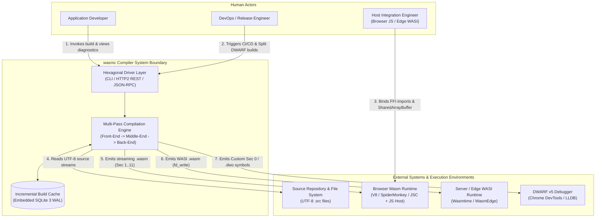
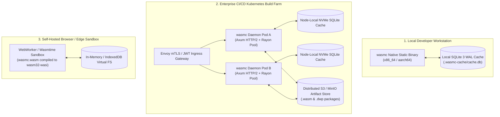
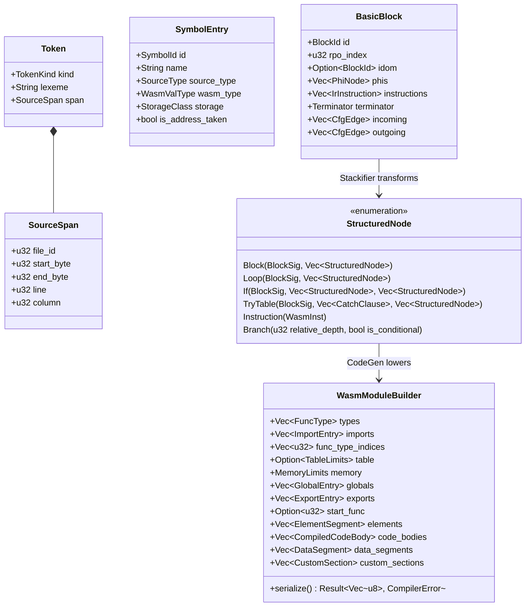
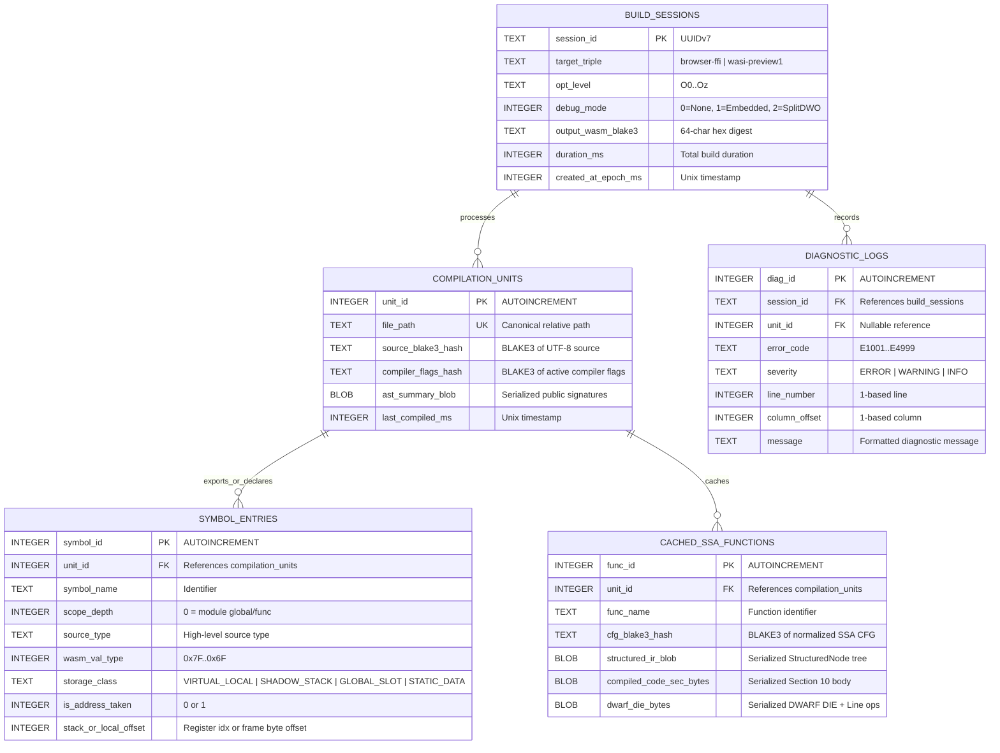
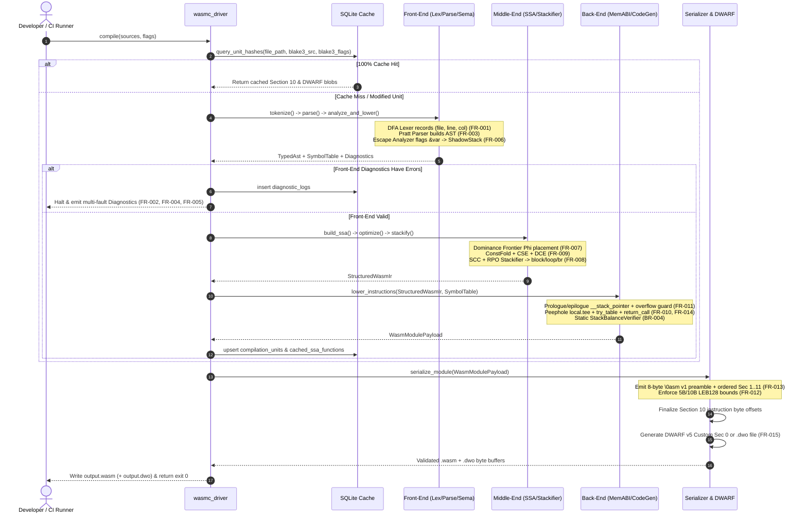
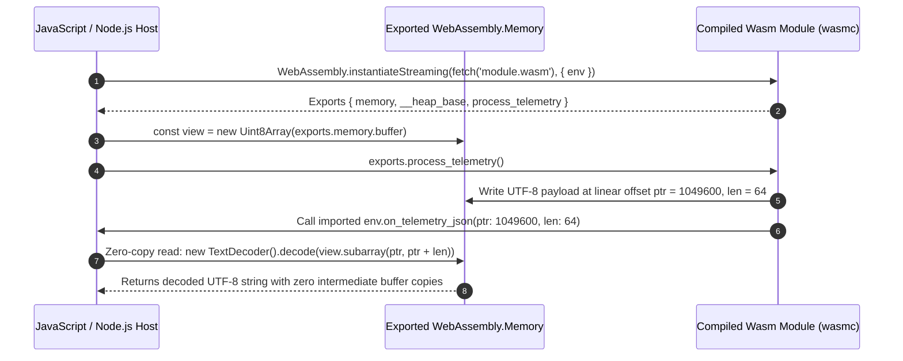
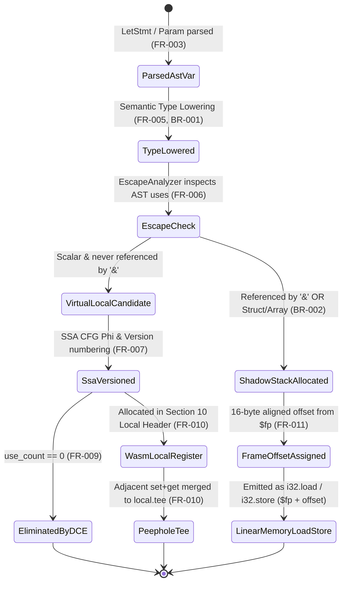

# Software Design Document (SDD): Direct-to-WebAssembly Systems Compiler (`wasmc`)

| Metadata Attribute | Value |
| :--- | :--- |
| **Document ID** | `SDD-WASMC-2026-MASTER` |
| **Version** | `2.0.0 (Consolidated Master Specification)` |
| **Date** | `October 15, 2026` |
| **Author** | `Senior Systems Architect & Compiler Lead` |
| **Project Name** | `Direct-to-WebAssembly Compiler (wasmc)` |
| **Consolidated Sources** | `wasm_compiler_srs.md (v1.0)`, `wasm_compiler_frd.md (v1.0)`, `HLD.md (v1.0)`, `LLD.md (v1.0)`, `SOURCE_GRAMMAR_AND_DECISIONS.md (v1.0)`, `QA_TEST_PLAN.md (v1.0)` |
| **Target Specification** | `W3C WebAssembly Core Specification 2.0 + Exception Handling & Tail Call Proposals + WASI Preview 1` |
| **Document Status** | `Approved — Production Implementation Baseline` |

---

## Table of Contents

1. [Introduction](#1-introduction)
   - [1.1 Purpose, Scope, and Intended Audience](#11-purpose-scope-and-intended-audience)
   - [1.2 Definitions, Acronyms, and Abbreviations](#12-definitions-acronyms-and-abbreviations)
   - [1.3 Normative and Informative References](#13-normative-and-informative-references)
2. [System Overview](#2-system-overview)
   - [2.1 Business Context, Problem Statement, and Engineering Goals](#21-business-context-problem-statement-and-engineering-goals)
   - [2.2 User Roles and System Personas](#22-user-roles-and-system-personas)
   - [2.3 System Context Architecture](#23-system-context-architecture)
3. [Architectural Design (High-Level Design)](#3-architectural-design-high-level-design)
   - [3.1 Architecture Style and Design Patterns](#31-architecture-style-and-design-patterns)
   - [3.2 Component and Module Breakdown](#32-component-and-module-breakdown)
   - [3.3 Technology Stack and Justification](#33-technology-stack-and-justification)
   - [3.4 Data Architecture and Inter-Component Data Flow](#34-data-architecture-and-inter-component-data-flow)
   - [3.5 External Interfaces and Integration Points](#35-external-interfaces-and-integration-points)
   - [3.6 Deployment View and Infrastructure Topology](#36-deployment-view-and-infrastructure-topology)
   - [3.7 Architectural Decision Records (ADRs) and Trade-Offs](#37-architectural-decision-records-adrs-and-trade-offs)
4. [Detailed Engineering Design (Low-Level Design)](#4-detailed-engineering-design-low-level-design)
   - [4.1 Source Language Formal EBNF Grammar and Operator Precedence](#41-source-language-formal-ebnf-grammar-and-operator-precedence)
   - [4.2 Detailed Subsystem and Module Specifications](#42-detailed-subsystem-and-module-specifications)
   - [4.3 Class Hierarchy, Data Structures, and Rust Trait Interfaces](#43-class-hierarchy-data-structures-and-rust-trait-interfaces)
   - [4.4 Linear Memory Topology, Shadow Stack, and ABI Layout](#44-linear-memory-topology-shadow-stack-and-abi-layout)
   - [4.5 Database Design: SQLite Incremental Compilation Cache](#45-database-design-sqlite-incremental-compilation-cache)
   - [4.6 CLI and HTTP/2 Daemon REST API Specifications](#46-cli-and-http2-daemon-rest-api-specifications)
   - [4.7 Core Compiler Algorithms and Business Logic](#47-core-compiler-algorithms-and-business-logic)
   - [4.8 Sequence Diagrams and State Transition Models](#48-sequence-diagrams-and-state-transition-models)
   - [4.9 Error Handling, Multi-Fault Recovery, and Logging Strategy](#49-error-handling-multi-fault-recovery-and-logging-strategy)
5. [Non-Functional Requirements (NFR) and Security Design](#5-non-functional-requirements-nfr-and-security-design)
   - [5.1 NFR Quantitative Design Mapping](#51-nfr-quantitative-design-mapping)
   - [5.2 Security Architecture and Threat Mitigation](#52-security-architecture-and-threat-mitigation)
6. [Verification, Validation, and QA Test Specification](#6-verification-validation-and-qa-test-specification)
   - [6.1 Four-Stage Continuous Verification Pipeline](#61-four-stage-continuous-verification-pipeline)
   - [6.2 Requirement-Mapped Verification Test Cases](#62-requirement-mapped-verification-test-cases)
7. [Design Constraints, Business Rules, Assumptions, and Dependencies](#7-design-constraints-business-rules-assumptions-and-dependencies)
8. [Risks and Mitigation Strategies](#8-risks-and-mitigation-strategies)
9. [Open Issues and Cross-Document Reconciliation Log](#9-open-issues-and-cross-document-reconciliation-log)
10. [Master End-to-End Traceability Matrix](#10-master-end-to-end-traceability-matrix)

---

## 1. Introduction

### 1.1 Purpose, Scope, and Intended Audience

#### Purpose
This Software Design Document (SDD) provides the complete, implementation-ready architectural and detailed engineering specification for the Direct-to-WebAssembly Compiler (`wasmc`). It unifies the macro-architecture of the High-Level Design (`HLD.md`), the module-level contracts and algorithms of the Low-Level Design (`LLD.md`), the formal language grammar, and the verification test plan into a single source of truth.

#### Scope
* **In Scope:**
  * **Front-End Pipeline (`FR-001`–`FR-006`):** Table-driven Deterministic Finite Automaton (DFA) lexical analysis with exact source coordinate tracking, panic-mode lexical recovery, hybrid Recursive Descent and Pratt expression parsing, phrase-level syntax recovery, hierarchical semantic type checking, primitive type lowering (`i32`, `i64`, `f32`, `f64`, `v128`, `funcref`, `externref`), and address-taken escape analysis.
  * **Middle-End IR & Optimization Pipeline (`FR-007`–`FR-009`):** Construction of a Control Flow Graph (CFG) in Static Single Assignment (SSA) form with dominance-frontier $\Phi$ (Phi) node placement, iterative Constant Folding, Dead Code Elimination (DCE), Common Subexpression Elimination (CSE), and Stackifier structured control-flow synthesis.
  * **Back-End Code Generation & Binary Serialization (`FR-010`–`FR-014`):** Stack-machine instruction selection, peephole `local.tee` register optimization, static operand stack balance verification, partitioned linear memory management (`Data`, downward-growing `__stack_pointer` shadow stack, upward-growing `__heap_base` dynamic heap), native `try_table` exception handling and `return_call` tail-call emission, bounded 5-byte/10-byte canonical LEB128 encoding, and strict Section 1–11 binary ordering.
  * **Debugging & Host Runtime Integration (`FR-015`–`FR-017`):** DWARF v5 symbol generation (`.debug_info`, `.debug_line`, `.debug_abbrev`, `.debug_str`) emitted either into Wasm Custom Sections (ID 0) or external `.dwo`/`.dwp` Debug Fission files, zero-copy `[ptr, len]` JavaScript FFI bindings, `wasi_snapshot_preview1` system call mappings, and deterministic `unreachable` trap injection.
  * **Build Infrastructure:** POSIX CLI executable, persistent HTTP/2 REST and JSON-RPC Compiler Daemon, and an embedded SQLite 3 WAL incremental compilation cache.
* **Out of Scope:**
  * Host WebAssembly virtual machine execution engines (delegated to compliant runtimes such as V8, SpiderMonkey, JavaScriptCore, Wasmtime, or WasmEdge).
  * Multi-stage transpilation through C, C++, LLVM IR, or Binaryen.
  * Legacy Emscripten Relooper control-flow state machines or JavaScript `setjmp`/`longjmp` exception wrappers.

#### Intended Audience
* **Compiler & Systems Engineers:** Implementing the Rust workspace crates (`wasmc_*`).
* **Runtime & Host Integration Engineers:** Integrating compiled `.wasm` modules with Browser JS/TS hosts and WASI serverless environments.
* **DevOps & Build Infrastructure Engineers:** Deploying the `wasmc` CLI and Kubernetes HTTP/2 build daemon cluster.
* **QA & Security Engineers:** Executing unit, fuzzing (`cargo-fuzz`), `wasm-validate` compliance, and DWARF E2E test suites.

---

### 1.2 Definitions, Acronyms, and Abbreviations

| Term / Acronym | Definition |
| :--- | :--- |
| **ABI** | Application Binary Interface — low-level calling conventions, register/stack layout, and type representations shared between a `.wasm` module and its host. |
| **AST** | Abstract Syntax Tree — hierarchical tree representation of the syntactic structure of source code produced by the parser. |
| **CFG** | Control Flow Graph — directed graph of basic blocks (`BasicBlock`) connected by control-transfer edges (`CfgEdge`). |
| **CSE / DCE** | Common Subexpression Elimination / Dead Code Elimination — machine-independent SSA optimization passes. |
| **DFA** | Deterministic Finite Automaton — finite-state machine recognizing lexical tokens in strictly linear $O(n)$ time. |
| **DIE / DWARF** | Debugging Information Entry / Debugging With Attributed Record Formats (v5) used by debuggers to map bytecode back to source code. |
| **Debug Fission** | Technique splitting DWARF debugging metadata out of the main `.wasm` binary into external `.dwo` / `.dwp` files. |
| **FFI** | Foreign Function Interface — mechanism allowing Wasm code to invoke imported host functions and share exported linear memory. |
| **LEB128** | Little Endian Base 128 — variable-length integer compression format (`ULEB128` for unsigned, `SLEB128` for signed two's complement). |
| **Pratt Parser** | Top-Down Operator Precedence parser using left and right binding powers `(left_bp, right_bp)` to parse expressions without deep grammar recursion. |
| **Relooper** | Legacy CFG-to-structured-control-flow algorithm that injects synthetic state variables and `switch` dispatch loops (explicitly rejected in `wasmc`). |
| **RPO / SCC** | Reverse Post-Order / Strongly Connected Component — graph-theoretic constructs used by the Stackifier algorithm to enclose loops and forward branches. |
| **Shadow Stack** | Software-managed stack region in WebAssembly linear memory indexed by a mutable global (`__stack_pointer`) for storing address-taken variables and structs. |
| **SSA** | Static Single Assignment — IR form where every virtual register is defined exactly once, using $\Phi$ nodes at control-flow join blocks. |
| **Stackifier** | Graph-reduction algorithm that translates arbitrary CFGs directly into nested Wasm `block`, `loop`, and `if` instructions using relative branch depths (`br`). |
| **WASI** | WebAssembly System Interface (`wasi_snapshot_preview1`) — standardized capability-based syscall API for non-browser environments. |

---

### 1.3 Normative and Informative References
1. **W3C Recommendation:** *WebAssembly Core Specification, Version 2.0* (`https://www.w3.org/TR/wasm-core-2/`).
2. **W3C WebAssembly CG:** *WebAssembly Exception Handling Proposal (`try_table`, `throw`, `catch`)* and *Tail Call Proposal (`return_call`, `return_call_indirect`)*.
3. **DWARF Standards Committee:** *DWARF Debugging Information Format, Version 5* (WebAssembly Custom Section Conventions).
4. **Bytecode Alliance:** *WASI (`wasi_snapshot_preview1`) ABI Specification*.
5. **Project Baseline Documents:** `wasm_compiler_srs.md` (v1.0.0), `wasm_compiler_frd.md` (v1.0.0), `HLD.md` (v1.0.0), `LLD.md` (v1.0.0), `SOURCE_GRAMMAR_AND_DECISIONS.md` (v1.0.0), and `QA_TEST_PLAN.md` (v1.0.0).

---

## 2. System Overview

### 2.1 Business Context, Problem Statement, and Engineering Goals

#### Problem Statement
Organizations deploying compute-intensive workloads across browsers, edge networks, and serverless runtimes suffer from slow build pipelines, bloated binary payloads, and degraded runtime performance when relying on legacy multi-stage toolchains. Traditional pipelines transpile source languages through C/C++ or heavyweight intermediate frameworks and rely on legacy control-flow flattening (such as Relooper) or JavaScript-emulated stack unwinding. These approaches inject synthetic state variables, inflate `.wasm` download sizes, delay browser streaming instantiation, and obscure source-level debugging.

#### Core Engineering Objectives
1. **Direct, Dependency-Free Binary Emission:** Translate high-level source code directly into validated `.wasm` binaries in a single native process without invoking external assemblers (`wat2wasm`, LLVM, or Binaryen).
2. **Single-Pass Streaming Instantiation (`BR-007`):** Emit module sections in strictly ascending order (Sections 1–11) so browser engines (`WebAssembly.instantiateStreaming`) validate signatures and compile functions while the payload is still downloading.
3. **Zero State-Machine Control Flow (`BR-003`):** Synthesize native `block`, `loop`, and `if` trees via the Stackifier algorithm, delivering up to 14% faster execution than Relooper baselines.
4. **Hardware-Isolated Memory Safety (`BR-002`, `BR-005`):** Keep non-escaped scalars in virtual registers (`local`) while routing address-taken variables (`&var`) and composites to a downward-growing linear memory shadow stack (`__stack_pointer`) cleanly separated from the upward-growing dynamic heap (`__heap_base`).
5. **Transparent Source Debugging (`FR-015`):** Preserve exact `(file, line, column)` spans from tokenization through peephole optimization into DWARF v5 Custom Sections (ID 0) or split `.dwo`/`.dwp` files.

---

### 2.2 User Roles and System Personas

| Persona | Role Description | Interaction with `wasmc` | Primary Requirements |
| :--- | :--- | :--- | :--- |
| **Application Developer** | Systems or application programmer authoring `.src` files targeting WebAssembly. | Invokes `wasmc` via CLI or IDE LSP server; relies on multi-fault error diagnostics and DWARF source breakpoints in Chrome DevTools / LLDB. | `FR-001`–`FR-006`, `FR-015` |
| **Host Integration Engineer** | JavaScript/TypeScript frontend engineer or Rust/Go backend engineer embedding `.wasm` modules. | Instantiates compiled `.wasm` modules, binds imported host functions, and exchanges strings/buffers via zero-copy `DataView`/`Uint8Array` views over exported `memory`. | `FR-011`, `FR-016`, `FR-017` |
| **DevOps / Release Engineer** | Infrastructure engineer managing CI/CD pipelines and edge deployments. | Runs `wasmc --daemon` build clusters, configures `--split-dwarf` artifact archiving, and verifies deterministic BLAKE3 binary digests. | `FR-012`, `FR-013`, `FR-015` |
| **Target Wasm Runtime (System Actor)** | Automated host validation and execution engine (V8, SpiderMonkey, JSC, Wasmtime). | Validates the 8-byte preamble, section ordering, LEB128 bounds, and stack balance at load time; executes bytecode and traps cleanly on `unreachable`. | `FR-010`, `FR-012`, `FR-013`, `FR-017` |

---

### 2.3 System Context Architecture



---

## 3. Architectural Design (High-Level Design)

### 3.1 Architecture Style and Design Patterns

`wasmc` implements a **Layered Multi-Pass Pipeline Architecture** wrapped inside a **Hexagonal (Ports and Adapters) Service Boundary**, supported by **Region-Based Arena Memory Management**:

1. **Multi-Pass Pipeline Pattern:** Each compilation stage accepts a well-typed immutable or arena-allocated input structure and produces a verified intermediate representation (`UTF-8 Bytes -> Vec<Token> -> UntypedAst -> TypedAst -> SsaCfg -> StructuredWasmIr -> WasmModulePayload -> Vec<u8>`). Whole-function analysis passes (Escape Analysis `FR-006`, SSA $\Phi$-placement `FR-007`, and Stackifier `FR-008`) complete before a single byte of Code Section (ID 10) is emitted, fulfilling Wasm's requirement that all locals be declared upfront (`BR-004`).
2. **Hexagonal Ports and Adapters:** The core compiler engine (`wasmc_driver`) exposes a pure Rust trait port (`CompilationSessionPort`). Transport adapters—POSIX CLI, Axum HTTP/2 REST Daemon, and Tower LSP/JSON-RPC—translate external requests into a canonical `CompileJobSpec` without polluting compiler passes with I/O concerns.
3. **Phase-Scoped Bump Arenas (`bumpalo`):** Compiler data structures (AST nodes, CFG blocks, SSA instructions) exhibit phase-bound lifetimes. Allocating nodes contiguously inside typed bump arenas provides $O(1)$ allocation, high CPU cache locality during tree/graph traversals, and instantaneous bulk deallocation upon pass completion.

```mermaid
flowchart LR
    subgraph Adapters ["Inbound Transport Adapters"]
        CLI_A["POSIX CLI Adapter"]
        REST_A["Axum HTTP/2 Daemon"]
        LSP_A["IDE JSON-RPC Adapter"]
    end

    subgraph Driver ["Orchestration Port"]
        DRV_P["wasmc_driver\n(CompilationSessionPort)"]
    end

    subgraph FrontEnd ["Front-End Layer (AstArena)"]
        LEX["wasmc_lexer\n(DFA Scanner)"]
        PAR["wasmc_parser\n(RD + Pratt)"]
        SEM["wasmc_sema\n(Type Lowering + Escape)"]
        LEX --> PAR --> SEM
    end

    subgraph MiddleEnd ["Middle-End Layer (IrArena)"]
        SSA["wasmc_ssa\n(CFG + Phi + ConstFold/DCE/CSE)"]
        SCF["wasmc_stackifier\n(SCC + Block/Loop Synthesis)"]
        SSA --> SCF
    end

    subgraph BackEnd ["Back-End Layer (Codegen Buffer)"]
        MEM["wasmc_mem_abi\n(Data / Shadow Stack / Heap / FFI)"]
        CGN["wasmc_codegen\n(Stack Lowering + local.tee + Verifier)"]
        DWF["wasmc_dwarf\n(DWARF v5 DIE + Line Matrix)"]
        SER["wasmc_serialize\n(LEB128 + Sec 1..11 Emitter)"]
        MEM --> CGN --> SER
        CGN --> DWF --> SER
    end

    subgraph Outbound ["Outbound Persistence & Artifact Ports"]
        CACHE_O[("SQLite 3 WAL Cache")]
        WASM_O[".wasm Binary File/Stream"]
        DWO_O[".dwo / .dwp Debug File"]
    end

    CLI_A & REST_A & LSP_A --> DRV_P
    DRV_P --> LEX
    SEM --> SSA
    SCF --> MEM
    DRV_P <--> CACHE_O
    SER --> WASM_O
    DWF --> DWO_O
```



---

### 3.2 Component and Module Breakdown

| HLD Component ID | LLD Rust Crate / Module | Layer | Core Responsibilities | Mapped Requirements |
| :--- | :--- | :--- | :--- | :--- |
| `COMP-DRV` | `wasmc_driver` | Ingestion / Control | Parses CLI/REST/RPC requests, manages arena lifetimes, coordinates SQLite incremental cache lookups, and sequences passes. | `FR-001`–`FR-017` |
| `COMP-LEX` | `wasmc_lexer` | Front-End | Scans UTF-8 byte streams via a 256-entry ASCII + UTF-8 DFA table, attaches `(file_id, line, col)` coordinates, and performs panic-mode recovery. | `FR-001`, `FR-002`, `FE-LEX-01`–`04` |
| `COMP-PAR` | `wasmc_parser` | Front-End | Validates declarations/statements via Recursive Descent and expressions via Pratt parsing; synchronizes on `;` or `}` after syntax faults. | `FR-003`, `FR-004`, `FE-PAR-01`–`04`, `FE-AST-01`–`03` |
| `COMP-SEM` | `wasmc_sema` | Front-End | Manages hierarchical symbol tables, lowers source types to Wasm primitives (`BR-001`), and flags address-taken variables (`&var`) for shadow-stack allocation (`BR-002`). | `FR-005`, `FR-006`, `FE-SEM-01`–`04` |
| `COMP-SSA` | `wasmc_ssa` | Middle-End | Lowers typed AST to SSA CFG, computes dominance frontiers for $\Phi$-node insertion, and runs Constant Folding, DCE, and CSE passes. | `FR-007`, `FR-009`, `IR-MIR-01`–`04`, `IR-OPT-01`–`04` |
| `COMP-SCF` | `wasmc_stackifier` | Middle-End | Eliminates $\Phi$ nodes, decomposes CFGs into SCCs, normalizes irreducible loops, and synthesizes nested `block`, `loop`, and `if` trees (`BR-003`). | `FR-008`, `CG-SCF-01`–`05` |
| `COMP-MEM` | `wasmc_mem_abi` | Back-End | Computes `Data` offsets, manages `__stack_pointer` and `__heap_base`, links default free-list allocator, enforces 64 KiB page bounds (`BR-005`), and maps FFI/WASI ABIs. | `FR-011`, `FR-016`, `FR-017`, `MM-LAY-01`–`04`, `MM-ABI-01`–`03`, `MM-ALC-01`–`02` |
| `COMP-CGN` | `wasmc_codegen` | Back-End | Lowers structured IR to Wasm opcodes, applies peephole `local.tee`, emits `try_table`, `return_call`, and `unreachable` traps, and verifies operand stack balance (`BR-004`). | `FR-010`, `FR-014`, `FR-017`, `CG-STK-01`–`04`, `RT-TRP-01`–`03` |
| `COMP-SER` | `wasmc_serialize` | Back-End | Enforces 5B/10B canonical LEB128 bounds (`BR-006`), writes the 8-byte `\0asm` Version 1 preamble, and serializes Sections 1–11 sequentially (`BR-007`). | `FR-012`, `FR-013`, `CG-BIN-01`–`05` |
| `COMP-DWF` | `wasmc_dwarf` | Back-End | Emits DWARF v5 `.debug_info`, `.debug_line`, `.debug_abbrev`, and `.debug_str` in Custom Section 0 or external `.dwo`/`.dwp` Debug Fission files. | `FR-015`, `CG-BIN-05` |
| `COMP-DIAG` | `wasmc_diagnostics` | Cross-Cutting | Collects multi-fault lexical, syntax, and semantic diagnostics with source snippets and outputs human ANSI, JSON, or SARIF reports. | `FR-002`, `FR-004`, `FR-005` |

---

### 3.3 Technology Stack and Justification

| Subsystem | Selected Technology | Rationale & Architectural Alignment |
| :--- | :--- | :--- |
| **Implementation Language** | **Rust (Edition 2024, MSRV 1.85+)** | Algebraic enums, exhaustive pattern matching, zero-cost abstractions, memory safety without GC pauses, and trivial self-compilation to `wasm32-wasi`. |
| **Arena Memory Allocator** | **`bumpalo` (Typed Region Arenas)** | Eliminates individual heap allocations/deallocations for millions of AST and SSA nodes, cutting middle-end memory overhead by >60%. |
| **Parallelism Engine** | **`rayon` (Work-Stealing Thread Pool)** | Parallelizes per-file lexing/parsing and per-function SSA optimization + Stackifier passes across all CPU cores while maintaining deterministic output ordering. |
| **Incremental Cache Store** | **SQLite 3 (`rusqlite` with `bundled` + WAL mode)** | Zero-configuration, single-file ACID relational database supporting concurrent readers and fast indexed lookup of BLAKE3 unit hashes. |
| **Daemon HTTP / RPC Stack** | **`axum` (HTTP/2) + `tower-lsp` (JSON-RPC 2.0)** | Enables remote CI build cluster execution and real-time IDE diagnostics using the exact same in-memory compiler pipeline. |
| **Cryptographic Hashing** | **`blake3` (SIMD-Accelerated)** | Computes content hashes for source files, CFG subgraphs, and deterministic `.wasm` artifacts at >4 GB/s per core. |
| **Compliance & Fuzz Harness** | **`wasm-tools` (`wasm-validate`) + `cargo-fuzz`** | Guarantees 100% W3C Core 2.0 binary compliance (`BR-004`, `BR-007`) and continuous fuzzing of the LEB128 codec (`BR-006`). |

---

### 3.4 Data Architecture and Inter-Component Data Flow

#### Data Stores
1. **`SourceBufferArena` (In-Memory Read-Only):** Holds memory-mapped UTF-8 source files (`memmap2`) indexed by a compact 32-bit `FileId`, plus line-start byte offset vectors for $O(\log n)$ coordinate lookup.
2. **`AstArena` (In-Memory Ephemeral):** Holds `UntypedAst` and `TypedAst` nodes, dropped immediately after SSA CFG construction completes.
3. **`IrArena` (In-Memory Ephemeral):** Holds `ControlFlowGraph`, `BasicBlock`, `PhiNode`, `DominatorTree`, and `StructuredNode` trees per function.
4. **Incremental Compilation Cache (`.wasmc-cache/cache.db` — Persistent SQLite):** Stores compilation session history, file BLAKE3 digests, symbol table exports, and pre-compiled function bytecode blobs.
5. **Output Artifact Streams (Persistent Disk / HTTP Response):** The serialized `.wasm` module and optional `.dwo`/`.dwp` Debug Fission package.

---

### 3.5 External Interfaces and Integration Points

| Interface ID | Interface Name | Protocol / Binary Contract | Direction | Mapped Requirements |
| :--- | :--- | :--- | :--- | :--- |
| `INT-CLI` | **POSIX Command-Line Interface** | CLI arguments, `stdout`/`stderr`, exit codes (`0` = success, `1` = compile error, `2` = internal fault) | Inbound | `FR-001`–`FR-017` |
| `INT-HTTP` | **Daemon REST Build API** | HTTP/2 JSON (`POST /api/v1/compile`, `POST /api/v1/validate`, `GET /api/v1/cache/status`) | Inbound | `FR-002`, `FR-004`, `FR-013` |
| `INT-JS-FFI` | **Browser / Node.js Host ABI** | Wasm Import Sec (ID 2) & Export Sec (ID 7); exported `WebAssembly.Memory`; `[i32 ptr, i32 len]` zero-copy string/slice tuples | Outbound (Runtime) | `FR-011`, `FR-016`, `RT-JS-01`–`04` |
| `INT-WASI` | **WASI Preview 1 System Interface** | `wasi_snapshot_preview1` (`fd_write`, `fd_read`, `args_get`, `environ_get`, `proc_exit`) | Outbound (Runtime) | `FR-017`, `RT-WASI-01`–`03` |
| `INT-DWARF` | **DWARF v5 Debug Symbol Contract** | Custom Section ID 0 (`.debug_info`, `.debug_line`, `.debug_abbrev`, `.debug_str`) or external `.dwo`/`.dwp` | Outbound (Tooling) | `FR-015`, `CG-BIN-05` |

---

### 3.6 Deployment View and Infrastructure Topology



---

### 3.7 Architectural Decision Records (ADRs) and Trade-Offs

| ADR ID | Decision Title | Alternatives Rejected | Justification & Trade-Off Analysis | Mapped Requirements |
| :--- | :--- | :--- | :--- | :--- |
| **ADR-001** | **Stackifier with SCC Loop Normalization over Relooper** | Emscripten Relooper; Reg2Mem Switch Lowering | Relooper injects synthetic `label` state variables and `switch` dispatch loops (`BR-003`). Stackifier uses dominance and SCC topological sorting to emit native `block`/`loop`/`br` structures, cutting code size and boosting runtime execution speed by up to 14%. | `FR-008`, `BR-003` |
| **ADR-002** | **Dual-Storage Variable Model (Virtual Locals + Linear Shadow Stack)** | All variables in Linear Memory; All variables in Wasm Locals | Wasm `local` registers have no memory addresses (`BR-002`), while placing all scalars in linear memory defeats JIT register allocation. Escape Analysis (`FR-006`) keeps non-escaped scalars in fast `local` registers and places `&var` and composites on the `__stack_pointer` shadow stack. | `FR-006`, `FR-011`, `BR-002` |
| **ADR-003** | **Direct In-Memory Binary Serialization over External Assembler** | Emit `.wat` text and invoke `wat2wasm` / Binaryen | Text formatting and subprocess invocation increase build times by 5x–10x. `wasmc` serializes Sections 1–11 and LEB128 payloads directly in memory. | `FR-012`, `FR-013`, `BR-006`, `BR-007` |
| **ADR-004** | **Native `try_table` and `return_call` Opcode Emission** | JS wrapper exception trampolines; loop rewriting only | Targets Wasm Core 2.0 native `try_table` (`0x1F`) and `return_call` (`0x12`) instructions (`FR-014`) for zero-cost exception handling and constant-stack arbitrary mutual tail recursion. | `FR-014` |
| **ADR-005** | **Structural Types + Function Pointers in v1.0 (Resolving `OQ-001`)** | Full C++ Multiple-Inheritance VTables in v1.0 | Supports `struct`, fixed arrays `[T; N]`, pointers `*T`, and first-class function pointers `fn(...) -> T` lowered via Section 4 (`Table`) and Section 9 (`Element`) `call_indirect`. Deferring class inheritance keeps the v1.0 type system deterministic and verifiable. | `FR-003`, `FR-005`, `FR-013` |
| **ADR-006** | **Bundled Segregated Free-List Allocator & Default Stack Guard (Resolving `OQ-002`, `OQ-003`)** | External-only `malloc`; unchecked shadow stack | Bundles a compact (<1.2 KiB) segregated free-list allocator (`__wasmc_alloc` / `__wasmc_free`) above `__heap_base` (disable via `--no-default-allocator`) and emits a 4-instruction prologue stack overflow check (`if $fp < DATA_END { unreachable }`) by default across `-O0`..`-O3` (disable via `--no-stack-check`). | `FR-011`, `FR-017`, `BR-005` |

---

## 4. Detailed Engineering Design (Low-Level Design)

### 4.1 Source Language Formal EBNF Grammar and Operator Precedence

#### 4.1.1 Complete EBNF Grammar (`FR-001`, `FR-003`)
```ebnf
(* === 1. Top-Level Module Structure === *)
Module          ::= TopLevelDecl* EOF ;

TopLevelDecl    ::= ImportDecl
                  | ExportDecl
                  | StructDecl
                  | GlobalDecl
                  | FunctionDecl ;

(* === 2. Module Declarations === *)
ImportDecl      ::= "import" StringLiteral StringLiteral "fn" Identifier "(" ParamList? ")" ReturnType? ";" ;
ExportDecl      ::= "export" ( FunctionDecl | GlobalDecl ) ;

StructDecl      ::= "struct" Identifier "{" StructField ( "," StructField )* ","? "}" ;
StructField     ::= Identifier ":" Type ;

GlobalDecl      ::= "global" "mut"? Identifier ":" Type "=" ConstExpr ";" ;

FunctionDecl    ::= "fn" Identifier "(" ParamList? ")" ReturnType? BlockStmt ;
ParamList       ::= Param ( "," Param )* ;
Param           ::= Identifier ":" Type ;
ReturnType      ::= "->" Type ;

(* === 3. Type System (Lowered to Wasm Primitives per BR-001) === *)
Type            ::= PrimitiveType
                  | PointerType
                  | ArrayType
                  | FuncPtrType
                  | StructTypeRef ;

PrimitiveType   ::= "i32" | "i64" | "u32" | "u64" | "f32" | "f64" | "bool" | "char" | "void" ;
PointerType     ::= "*" Type ;
ArrayType       ::= "[" Type ";" IntegerLiteral "]" ;
FuncPtrType     ::= "fn" "(" TypeList? ")" ReturnType? ;
TypeList        ::= Type ( "," Type )* ;
StructTypeRef   ::= Identifier ;

(* === 4. Statements (Parsed via Recursive Descent) === *)
Stmt            ::= LetStmt
                  | AssignStmt
                  | IfStmt
                  | WhileStmt
                  | ReturnStmt
                  | BreakStmt
                  | ContinueStmt
                  | TryCatchStmt
                  | ThrowStmt
                  | ExprStmt
                  | BlockStmt ;

BlockStmt       ::= "{" Stmt* "}" ;
LetStmt         ::= "let" "mut"? Identifier ":" Type ( "=" Expr )? ";" ;
AssignStmt      ::= LValue "=" Expr ";" ;
IfStmt          ::= "if" "(" Expr ")" BlockStmt ( "else" ( IfStmt | BlockStmt ) )? ;
WhileStmt       ::= "while" "(" Expr ")" BlockStmt ;
ReturnStmt      ::= "return" "tail"? Expr? ";" ;
BreakStmt       ::= "break" ";" ;
ContinueStmt    ::= "continue" ";" ;
TryCatchStmt    ::= "try" BlockStmt "catch" "(" Identifier ":" Type ")" BlockStmt ;
ThrowStmt       ::= "throw" Expr ";" ;
ExprStmt        ::= Expr ";" ;

LValue          ::= Identifier
                  | "*" UnaryExpr
                  | PostfixExpr "." Identifier
                  | PostfixExpr "[" Expr "]" ;

(* === 5. Expressions (Parsed via Pratt Binding Powers) === *)
Expr            ::= LogicOrExpr ;
LogicOrExpr     ::= LogicAndExpr ( "||" LogicAndExpr )* ;
LogicAndExpr    ::= BitOrExpr ( "&&" BitOrExpr )* ;
BitOrExpr       ::= BitXorExpr ( "|" BitXorExpr )* ;
BitXorExpr      ::= BitAndExpr ( "^" BitXorExpr )* ;
BitAndExpr      ::= EqualityExpr ( "&" EqualityExpr )* ;
EqualityExpr    ::= RelExpr ( ( "==" | "!=" ) RelExpr )* ;
RelExpr         ::= ShiftExpr ( ( "<" | "<=" | ">" | ">=" ) ShiftExpr )* ;
ShiftExpr       ::= AddExpr ( ( "<<" | ">>" ) AddExpr )* ;
AddExpr         ::= MulExpr ( ( "+" | "-" ) MulExpr )* ;
MulExpr         ::= UnaryExpr ( ( "*" | "/" | "%" ) UnaryExpr )* ;

UnaryExpr       ::= ( "-" | "!" | "~" | "&" | "*" ) UnaryExpr
                  | PostfixExpr ;

PostfixExpr     ::= PrimaryExpr ( CallSuffix | IndexSuffix | MemberSuffix )* ;
CallSuffix      ::= "(" ArgList? ")" ;
IndexSuffix     ::= "[" Expr "]" ;
MemberSuffix    ::= "." Identifier ;
ArgList         ::= Expr ( "," Expr )* ;

PrimaryExpr     ::= IntegerLiteral
                  | FloatLiteral
                  | BoolLiteral
                  | CharLiteral
                  | StringLiteral
                  | Identifier
                  | "(" Expr ")" ;

(* === 6. Lexical Tokens === *)
Identifier      ::= [a-zA-Z_] [a-zA-Z0-9_]* ;
IntegerLiteral  ::= "0x" [0-9a-fA-F]+ | [0-9]+ ;
FloatLiteral    ::= [0-9]+ "." [0-9]+ ( [eE] [+-]? [0-9]+ )? ;
BoolLiteral     ::= "true" | "false" ;
CharLiteral     ::= "'" ( [^'\\\n\r] | EscapeSeq ) "'" ;
StringLiteral   ::= '"' ( [^"\\\n\r] | EscapeSeq )* '"' ;
EscapeSeq       ::= "\\" [nrt\\'"0] ;
```

#### 4.1.2 Pratt Parser Operator Precedence & Wasm Opcode Lowering Matrix
| Precedence | Operator(s) | Associativity | Pratt `(left_bp, right_bp)` | Lowered Wasm Opcode(s) (`i32` / `i64` / `f64`) |
| :--- | :--- | :--- | :--- | :--- |
| **10 (Highest)** | `()`, `[]`, `.` | Left-to-Right | `(20, 21)` | `call` (`0x10`), `call_indirect` (`0x11`), `i32.load` (`0x28`), `i32.store` (`0x36`) |
| **9 (Unary)** | `-`, `!`, `~`, `&`, `*` | Right-to-Left | `(—, 18)` | `i32.eqz` (`0x45`), `i32.xor -1`, Frame Offset Calc, `i32.load` (`0x28`) |
| **8 (Multiplicative)** | `*`, `/`, `%` | Left-to-Right | `(15, 16)` | `i32.mul` (`0x6C`), `i32.div_s` (`0x6D`), `i32.div_u` (`0x6E`), `i32.rem_s` (`0x6F`) |
| **7 (Additive)** | `+`, `-` | Left-to-Right | `(13, 14)` | `i32.add` (`0x6A`), `i32.sub` (`0x6B`), `f64.add` (`0xA0`), `f64.sub` (`0xA1`) |
| **6 (Bitwise Shift)** | `<<`, `>>` | Left-to-Right | `(11, 12)` | `i32.shl` (`0x74`), `i32.shr_s` (`0x75`), `i32.shr_u` (`0x76`) |
| **5 (Relational)** | `<`, `<=`, `>`, `>=` | Left-to-Right | `(9, 10)` | `i32.lt_s` (`0x48`), `i32.le_s` (`0x4C`), `i32.gt_s` (`0x4A`), `i32.ge_s` (`0x4E`) |
| **4 (Equality)** | `==`, `!=` | Left-to-Right | `(7, 8)` | `i32.eq` (`0x46`), `i32.ne` (`0x47`), `f64.eq` (`0x61`), `f64.ne` (`0x62`) |
| **3 (Bitwise)** | `&`, `^`, `\|` | Left-to-Right | `(5, 6)` | `i32.and` (`0x71`), `i32.xor` (`0x73`), `i32.or` (`0x72`) |
| **2 (Logical AND)** | `&&` | Left-to-Right | `(3, 4)` | `if (result i32) <rhs> else i32.const 0 end` |
| **1 (Logical OR)** | `\|\|` | Left-to-Right | `(1, 2)` | `if (result i32) i32.const 1 else <rhs> end` |

---

### 4.2 Detailed Subsystem and Module Specifications

#### 4.2.1 `wasmc_lexer` (`COMP-LEX` — `FR-001`, `FR-002`)
* Implements a 256-entry ASCII jump table (`ASCII_CLASS_TABLE: [CharClass; 256]`) combined with UTF-8 multi-byte validation for string/char literals and comments.
* Maintains a monotonically increasing byte cursor and line-offset index, attaching a 16-byte `SourceSpan { file_id, start_byte, end_byte, line, column }` to every emitted `Token`.
* **Panic-Mode Recovery (`FR-002`):** When an unrecognized byte sequence is encountered, `DfaLexer` records `DiagnosticCode::E1001_IllegalCharacter` in `DiagnosticSink`, advances the cursor by one UTF-8 scalar value, and resumes tokenizing without halting.

#### 4.2.2 `wasmc_parser` (`COMP-PAR` — `FR-003`, `FR-004`)
* Parses module-level declarations and block statements via Recursive Descent (`parse_top_level_decl`, `parse_stmt`) and expressions via Pratt operator precedence (`parse_expr_bp(min_bp: u8)`).
* **Phrase-Level Synchronization (`FR-004`):** When a token mismatch occurs, `Parser::synchronize()` logs `E2001_UnexpectedToken` and advances the token stream until encountering a statement terminator (`;`), block boundary (`}`), or top-level declaration keyword (`fn`, `struct`, `import`, `export`, `global`).

#### 4.2.3 `wasmc_sema` (`COMP-SEM` — `FR-005`, `FR-006`, `BR-001`, `BR-002`)
* **Scoped Symbol Resolution:** Uses a tree of lexical scopes (`ScopeArena`) supporting O(1) shadowed identifier lookup.
* **Primitive Type Lowering (`BR-001`):** Maps `bool`, `char`, `i8`/`u8`/`i16`/`u16`, `*T` pointers, and `fn(...)` table indices to `WasmValType::I32`; `i64`/`u64` to `WasmValType::I64`; `f32` to `WasmValType::F32`; `f64` to `WasmValType::F64`.
* **Address-Taken Escape Analyzer (`FR-006`, `BR-002`):** Walks every function AST. Any variable referenced via unary `&var`, passed by pointer, or having a composite type (`struct` or fixed array `[T; N]`) is marked `is_address_taken = true` and assigned `StorageClass::ShadowStack`. All remaining scalar locals are assigned `StorageClass::VirtualLocal`.

#### 4.2.4 `wasmc_ssa` (`COMP-SSA` — `FR-007`, `FR-009`)
* Lowers `TypedAst` into basic blocks (`BasicBlock`) terminated by explicit control-flow instructions (`Branch`, `CondBranch`, `Return`, `Throw`, `Unreachable`).
* Computes the Dominator Tree via the Cooper-Harvey-Kennedy iterative algorithm and places minimal $\Phi$ (`PhiNode`) instructions along dominance frontiers for all `VirtualLocal` variables (`FR-007`).
* Runs a 3-pass iterative optimization loop (`FR-009`):
  1. **Constant Folding & Propagation:** Replaces constant arithmetic/logical instructions with constant literals and simplifies constant conditional branches (`br_if const_1` $\rightarrow$ unconditional `br`).
  2. **Common Subexpression Elimination (CSE):** Uses dominator-scoped value numbering (`HashMap<(IrOpcode, SmallVec<[ValueId; 3]>), ValueId>`) to deduplicate pure computations.
  3. **Dead Code Elimination (DCE):** Marks live instructions starting from roots (memory stores, calls, returns, throws, traps) and sweeps unreferenced instructions and unreachable basic blocks.

#### 4.2.5 `wasmc_stackifier` (`COMP-SCF` — `FR-008`, `BR-003`)
* Deconstructs SSA $\Phi$ nodes into predecessor parallel copy coalescing.
* Identifies Strongly Connected Components (SCCs) via Tarjan's algorithm; if an SCC has multiple entry headers (irreducible loop), clones the smaller shared path so every loop has a single dominating entry header.
* Computes Reverse Post-Order (RPO) and translates all edges into structured `Block`, `Loop`, `If`, and `TryTable` containers with relative branch depths (`br $depth`, `br_if $depth`) and zero synthetic state variables.

#### 4.2.6 `wasmc_mem_abi` & `wasmc_codegen` (`COMP-MEM`, `COMP-CGN` — `FR-010`, `FR-011`, `FR-014`, `FR-016`, `FR-017`)
* Synthesizes function prologues/epilogues managing Global `#0` (`__stack_pointer`).
* Lowers SSA instructions to stack operations, merging adjacent `[local.set $x, local.get $x]` instructions into `[local.tee $x]` (`FR-010`).
* Emits `return_call` (`0x12`) and `return_call_indirect` (`0x13`) for `return tail` statements, and `try_table` (`0x1F`) with `catch` clauses for `try/catch` blocks (`FR-014`).
* Executes `StackBalanceVerifier` over every function body to prove static type and height equilibrium at every block boundary (`BR-004`).

#### 4.2.7 `wasmc_serialize` & `wasmc_dwarf` (`COMP-SER`, `COMP-DWF` — `FR-012`, `FR-013`, `FR-015`)
* Serializes the 8-byte `\0asm` Version 1 preamble and Sections 1–11 in strictly ascending order using bounded canonical LEB128 encoding (`BR-006`, `BR-007`).
* After Section 10 (`Code`) instruction byte offsets are finalized, `wasmc_dwarf` emits `.debug_abbrev`, `.debug_info`, `.debug_line`, and `.debug_str` either as Custom Sections (`ID 0`) or into an external `.dwo`/`.dwp` file.

---

### 4.3 Class Hierarchy, Data Structures, and Rust Trait Interfaces



#### Core Rust Data Structures and Trait Definitions
```rust
/// Exact source coordinates preserved from Lexer through DWARF emission (FR-001, FR-015)
#[derive(Debug, Clone, Copy, PartialEq, Eq, Hash)]
pub struct SourceSpan {
    pub file_id: u32,
    pub start_byte: u32,
    pub end_byte: u32,
    pub line: u32,
    pub column: u32,
}

/// WebAssembly Core 2.0 Value Types (FR-005, BR-001)
#[repr(u8)]
#[derive(Debug, Clone, Copy, PartialEq, Eq, Hash)]
pub enum WasmValType {
    I32       = 0x7F,
    I64       = 0x7E,
    F32       = 0x7D,
    F64       = 0x7C,
    V128      = 0x7B,
    FuncRef   = 0x70,
    ExternRef = 0x6F,
}

/// Variable storage allocation class assigned by Escape Analysis (FR-006, BR-002)
#[derive(Debug, Clone, Copy, PartialEq, Eq)]
pub enum StorageClass {
    VirtualLocal { local_idx: u32 },
    ShadowStack  { frame_offset: i32, size_bytes: u32, align_bytes: u32 },
    GlobalSlot   { global_idx: u32, mutable: bool },
    StaticData   { linear_offset: u32, size_bytes: u32 },
}

/// Canonical Wasm Section Identifiers (FR-013, BR-007)
#[repr(u8)]
#[derive(Debug, Clone, Copy, PartialEq, Eq, PartialOrd, Ord)]
pub enum SectionId {
    Custom    = 0,
    Type      = 1,
    Import    = 2,
    Function  = 3,
    Table     = 4,
    Memory    = 5,
    Global    = 6,
    Export    = 7,
    Start     = 8,
    Element   = 9,
    Code      = 10,
    Data      = 11,
}

/// Core Wasm Opcodes emitted by `wasmc_codegen` (FR-010, FR-014, FR-017)
#[derive(Debug, Clone, PartialEq)]
pub enum WasmInst {
    Unreachable,                        // 0x00 (FR-017)
    Nop,                                // 0x01
    Block(BlockType),                   // 0x02
    Loop(BlockType),                    // 0x03
    If(BlockType),                      // 0x04
    Else,                               // 0x05
    TryTable(BlockType, Vec<CatchTag>), // 0x1F (FR-014)
    Throw(u32),                         // 0x08 (FR-014)
    End,                                // 0x0B
    Br(u32),                            // 0x0C (FR-008)
    BrIf(u32),                          // 0x0D (FR-008)
    Return,                             // 0x0F
    Call(u32),                          // 0x10
    CallIndirect(u32, u32),             // 0x11
    ReturnCall(u32),                    // 0x12 (FR-014)
    ReturnCallIndirect(u32, u32),       // 0x13 (FR-014)
    Drop,                               // 0x1A
    LocalGet(u32),                      // 0x20
    LocalSet(u32),                      // 0x21
    LocalTee(u32),                      // 0x22 (FR-010)
    GlobalGet(u32),                     // 0x23
    GlobalSet(u32),                     // 0x24
    I32Load { align: u32, offset: u32 },// 0x28
    I32Store { align: u32, offset: u32 },// 0x36
    MemorySize(u8),                     // 0x3F
    MemoryGrow(u8),                     // 0x40 (FR-011)
    I32Const(i32),                      // 0x41
    I64Const(i64),                      // 0x42
    F32Const(f32),                      // 0x43
    F64Const(f64),                      // 0x44
    I32Eqz,                             // 0x45
    I32Eq,                              // 0x46
    I32LtS,                             // 0x48
    I32LtU,                             // 0x49
    I32Add,                             // 0x6A
    I32Sub,                             // 0x6B
    I32Mul,                             // 0x6C
    I32DivS,                            // 0x6D
}

/// Bounded LEB128 Serialization Contract (FR-012, BR-006)
pub trait Leb128Codec {
    fn encode_u32(out: &mut Vec<u8>, value: u32) -> usize;
    fn encode_i32(out: &mut Vec<u8>, value: i32) -> usize;
    fn encode_u64(out: &mut Vec<u8>, value: u64) -> usize;
    fn encode_i64(out: &mut Vec<u8>, value: i64) -> usize;
    fn decode_u32(input: &[u8]) -> Result<(u32, usize), Leb128Error>;
    fn decode_i32(input: &[u8]) -> Result<(i32, usize), Leb128Error>;
    fn decode_u64(input: &[u8]) -> Result<(u64, usize), Leb128Error>;
    fn decode_i64(input: &[u8]) -> Result<(i64, usize), Leb128Error>;
}
```

---

### 4.4 Linear Memory Topology, Shadow Stack, and ABI Layout

WebAssembly linear memory is allocated in 64 KiB (`65,536`-byte) pages (`BR-005`) and partitioned into three non-overlapping segments to prevent stack-heap collisions (`FR-011`):

```mermaid
block-beta
    columns 1
    block:LowMem["1. Static Data Region (Section ID 11: Data)"]
        A["0x0000_0000 .. 0x0000_03FF : Null-Pointer Guard Zone (1024 Bytes Reserved)"]
        B["0x0000_0400 .. DATA_END    : String Literals, Constant Arrays, Global Structs (8-Byte Aligned)"]
    end
    block:StackMem["2. Linear Memory Shadow Stack (Default: 1 MiB = 16 Pages)"]
        C["DATA_END (__stack_limit) <-- Guard Boundary (Stack Overflow Traps if $fp < DATA_END)"]
        D["... Shadow Stack Frames Grow DOWNWARD (16-Byte Aligned Frame Allocations) ..."]
        E["Global #0: __stack_pointer (Mutable i32) Initialized to __heap_base"]
    end
    block:HeapMem["3. Dynamic Heap Region (Managed via memory.grow in 64 KiB Increments)"]
        F["Exported Symbol: __heap_base (Starts Immediately Above Shadow Stack Top)"]
        G["... Dynamic Allocations (__wasmc_alloc / __wasmc_free) Grow UPWARD ..."]
        H["Current Linear Memory Ceiling (Page Count * 65,536 Bytes)"]
    end
```



#### Memory ABI Invariants
1. **Null-Pointer Reservation (`[0x0000_0000 .. 0x0000_03FF]`):** The first 1024 bytes of linear memory are left unallocated so valid static data pointers never evaluate to `0` (`null`).
2. **16-Byte Shadow Frame Alignment:** Every function allocating shadow-stack space rounds its frame size up to a multiple of 16 bytes, maintaining SIMD (`v128`) and 64-bit alignment invariants.
3. **Zero-Copy Host String/Slice Tuple ABI (`FR-016`):** Strings and byte slices are passed across FFI boundaries as two `i32` arguments `(ptr: i32, len: i32)` pointing directly into exported `WebAssembly.Memory`.

---

### 4.5 Database Design: SQLite Incremental Compilation Cache

#### 4.5.1 Entity-Relationship Diagram (ERD)


#### 4.5.2 SQLite 3 DDL Schema (`.wasmc-cache/cache.db`)
```sql
PRAGMA journal_mode = WAL;
PRAGMA synchronous = NORMAL;
PRAGMA foreign_keys = ON;

CREATE TABLE IF NOT EXISTS build_sessions (
    session_id          TEXT PRIMARY KEY,
    target_triple       TEXT NOT NULL CHECK (target_triple IN ('browser-ffi', 'wasi-preview1')),
    opt_level           TEXT NOT NULL CHECK (opt_level IN ('O0', 'O1', 'O2', 'O3', 'Os', 'Oz')),
    debug_mode          INTEGER NOT NULL CHECK (debug_mode IN (0, 1, 2)),
    output_wasm_blake3  TEXT NOT NULL,
    duration_ms         INTEGER NOT NULL CHECK (duration_ms >= 0),
    created_at_epoch_ms INTEGER NOT NULL
);

CREATE TABLE IF NOT EXISTS compilation_units (
    unit_id             INTEGER PRIMARY KEY AUTOINCREMENT,
    file_path           TEXT NOT NULL UNIQUE,
    source_blake3_hash  TEXT NOT NULL,
    compiler_flags_hash TEXT NOT NULL,
    ast_summary_blob    BLOB NOT NULL,
    last_compiled_ms    INTEGER NOT NULL
);

CREATE INDEX IF NOT EXISTS idx_units_hash_lookup
    ON compilation_units(file_path, source_blake3_hash, compiler_flags_hash);

CREATE TABLE IF NOT EXISTS symbol_entries (
    symbol_id             INTEGER PRIMARY KEY AUTOINCREMENT,
    unit_id               INTEGER NOT NULL REFERENCES compilation_units(unit_id) ON DELETE CASCADE,
    symbol_name           TEXT NOT NULL,
    scope_depth           INTEGER NOT NULL CHECK (scope_depth >= 0),
    source_type           TEXT NOT NULL,
    wasm_val_type         INTEGER NOT NULL CHECK (wasm_val_type IN (127, 126, 125, 124, 123, 112, 111)),
    storage_class         TEXT NOT NULL CHECK (storage_class IN ('VIRTUAL_LOCAL', 'SHADOW_STACK', 'GLOBAL_SLOT', 'STATIC_DATA')),
    is_address_taken      INTEGER NOT NULL CHECK (is_address_taken IN (0, 1)),
    stack_or_local_offset INTEGER NOT NULL
);

CREATE INDEX IF NOT EXISTS idx_symbols_unit_name
    ON symbol_entries(unit_id, symbol_name);

CREATE TABLE IF NOT EXISTS cached_ssa_functions (
    func_id                 INTEGER PRIMARY KEY AUTOINCREMENT,
    unit_id                 INTEGER NOT NULL REFERENCES compilation_units(unit_id) ON DELETE CASCADE,
    func_name               TEXT NOT NULL,
    cfg_blake3_hash         TEXT NOT NULL,
    structured_ir_blob      BLOB NOT NULL,
    compiled_code_sec_bytes BLOB NOT NULL,
    dwarf_die_bytes         BLOB,
    UNIQUE(unit_id, func_name)
);

CREATE INDEX IF NOT EXISTS idx_ssa_cfg_hash
    ON cached_ssa_functions(cfg_blake3_hash);

CREATE TABLE IF NOT EXISTS diagnostic_logs (
    diag_id       INTEGER PRIMARY KEY AUTOINCREMENT,
    session_id    TEXT NOT NULL REFERENCES build_sessions(session_id) ON DELETE CASCADE,
    unit_id       INTEGER REFERENCES compilation_units(unit_id) ON DELETE SET NULL,
    error_code    TEXT NOT NULL,
    severity      TEXT NOT NULL CHECK (severity IN ('ERROR', 'WARNING', 'INFO')),
    line_number   INTEGER NOT NULL CHECK (line_number >= 1),
    column_offset INTEGER NOT NULL CHECK (column_offset >= 1),
    message       TEXT NOT NULL
);

CREATE INDEX IF NOT EXISTS idx_diag_session
    ON diagnostic_logs(session_id, severity);
```

---

### 4.6 CLI and HTTP/2 Daemon REST API Specifications

#### 4.6.1 Command-Line Interface (CLI) Contract
```text
USAGE:
    wasmc [OPTIONS] <INPUT_FILES>... -o <OUTPUT_WASM>

ARGUMENTS:
    <INPUT_FILES>...                  One or more UTF-8 source files (.src)

OPTIONS:
    -o, --output <PATH>               Output .wasm binary file path
    -t, --target <TARGET>             Target ABI: [browser-ffi | wasi-preview1] (default: browser-ffi)
    -O, --opt-level <0|1|2|3|s|z>     Optimization level (0=None, 2=ConstFold+DCE+CSE, z=Size) (default: 2)
    -g, --debug                       Emit DWARF v5 symbols in Custom Section ID 0 (FR-015)
        --split-dwarf <DWO_PATH>      Emit DWARF symbols into external .dwo/.dwp file (FR-015)
        --stack-size <BYTES>          Shadow stack size in 64KiB multiples (default: 1048576) (FR-011)
        --initial-memory <PAGES>      Initial linear memory in 64KiB pages (default: 32) (BR-005)
        --max-memory <PAGES>          Maximum linear memory in 64KiB pages (default: 65536) (BR-005)
        --no-default-allocator        Omit built-in segregated free-list heap allocator (ADR-006)
        --no-stack-check              Omit function prologue shadow-stack overflow trap check (ADR-006)
        --enable-exceptions <BOOL>    Emit native Wasm try_table/throw opcodes (default: true) (FR-014)
        --enable-tail-calls <BOOL>    Emit native Wasm return_call opcodes (default: true) (FR-014)
        --error-format <FMT>          Diagnostic output format: [human | json | sarif] (default: human)
        --cache-dir <DIR>             Path to incremental SQLite build cache (default: .wasmc-cache)
        --daemon <HOST:PORT>          Run persistent HTTP/2 REST + JSON-RPC build daemon
```

#### 4.6.2 HTTP/2 REST Build Service Endpoints

| Endpoint | HTTP Method | Auth | Description | Status Codes |
| :--- | :--- | :--- | :--- | :--- |
| `/api/v1/compile` | `POST` | Bearer JWT / mTLS | Compiles source files into `.wasm` + optional `.dwo` and returns Base64 binary, BLAKE3 hash, memory layout, and diagnostics. | `200 OK`, `400 Bad Request`, `413 Payload Too Large`, `422 Unprocessable Entity`, `500 Internal Error` |
| `/api/v1/validate` | `POST` | Bearer JWT / mTLS | Executes Lexer, Parser, Semantic/Escape Analysis, and LEB128 bounds verification without code emission. | `200 OK`, `400 Bad Request`, `422 Unprocessable Entity` |
| `/api/v1/artifacts/{id}.dwo` | `GET` | Bearer JWT / mTLS | Downloads the split DWARF `.dwo`/`.dwp` package generated for a compilation session. | `200 OK`, `404 Not Found` |
| `/api/v1/cache/status` | `GET` | Bearer JWT / mTLS | Returns SQLite incremental cache hit ratio, cached unit count, and WAL file metrics. | `200 OK`, `401 Unauthorized` |
| `/api/v1/health` | `GET` | None | Kubernetes liveness/readiness probe. | `200 OK`, `503 Service Unavailable` |

#### `POST /api/v1/compile` — Request & Response Example
```json
// REQUEST
{
  "project_id": "strider_telemetry_core",
  "target": "wasi-preview1",
  "opt_level": "O2",
  "debug_mode": "split_dwo",
  "memory_config": {
    "initial_pages": 32,
    "max_pages": 512,
    "shadow_stack_bytes": 1048576,
    "emit_stack_overflow_check": true,
    "bundle_default_allocator": true
  },
  "features": {
    "exceptions": true,
    "tail_calls": true
  },
  "sources": [
    {
      "path": "src/math.src",
      "content_utf8": "export fn clamp_add(a: i32, b: i32) -> i32 { let mut tmp: i32 = a + (4 * 8); let ptr: *i32 = &tmp; return *ptr + b; }"
    }
  ]
}

// RESPONSE (200 OK)
{
  "status": "SUCCESS",
  "session_id": "01928f10-4c9a-7b11-8a32-99c102e4b001",
  "duration_ms": 11,
  "cache_hit": false,
  "artifacts": {
    "wasm_base64": "AGFzbQEAAAABBgFgAn9/AX8DAgEABQMBIACg...",
    "wasm_blake3_hash": "4a8b19c02d73f9e8114087b5e2a931d6c40928f1a774b0012c9e54d8a3f71029",
    "wasm_size_bytes": 214,
    "dwo_download_url": "/api/v1/artifacts/01928f10-4c9a-7b11-8a32-99c102e4b001.dwo",
    "memory_layout": {
      "null_guard_end": 1024,
      "static_data_end": 1024,
      "stack_limit": 1024,
      "stack_pointer_init": 1049600,
      "heap_base": 1049600
    }
  },
  "diagnostics": []
}
```

---

### 4.7 Core Compiler Algorithms and Business Logic

#### 4.7.1 Address-Taken Escape Analysis & Shadow Frame Layout (`FR-006`, `FR-011`, `BR-002`)
```text
ALGORITHM: AnalyzeEscapeAndLayoutFrame(FunctionAST F)
INPUT:  Typed FunctionAST F with local variable declarations V = {v_1, ..., v_k}
OUTPUT: Updated StorageClass for each v_i and 16-byte aligned FrameSize(F)

1. Initialize escaped_vars = [], virtual_local_counter = F.params.len()
2. Walk all statements and expressions in F:
   For each node N in F:
     If N is UnaryOp(AddressOf, Expr::Var(v)):
       v.is_address_taken = true
     If N is VarDecl(v) where v.type is Struct or FixedArray:
       v.is_address_taken = true
3. For each variable v in V:
   If v.is_address_taken == true:
     escaped_vars.push(v)
   Else:
     v.storage = StorageClass::VirtualLocal { local_idx: virtual_local_counter }
     virtual_local_counter += 1
4. If escaped_vars is empty:
   RETURN FrameSize(F) = 0
5. Sort escaped_vars by alignment descending (16B -> 8B -> 4B -> 2B -> 1B) to minimize padding.
6. current_offset = 0
7. For each v in escaped_vars:
   padding = (v.align - (current_offset % v.align)) % v.align
   current_offset += padding
   v.storage = StorageClass::ShadowStack {
     frame_offset: current_offset,
     size_bytes: v.size,
     align_bytes: v.align
   }
   current_offset += v.size
8. FrameSize(F) = CEIL(current_offset / 16.0) * 16
9. RETURN FrameSize(F)
```

#### 4.7.2 Stackifier Structured Control Flow Synthesis (`FR-008`, `BR-003`)
```text
ALGORITHM: StackifyCFG(NormalizedCFG G)
INPUT:  Single-entry-loop SSA Control Flow Graph G = (Blocks, Edges)
OUTPUT: Sequence of StructuredNode instructions using block, loop, if, br, br_if

1. Compute DominatorTree(G) and Reverse Post-Order sequence RPO = [B_0, B_1, ..., B_n].
2. Classify each directed edge e = (B_src -> B_dst):
   - If RPO_Index(B_dst) <= RPO_Index(B_src): e.kind = EdgeKind::Back (Loop continue target)
   - Else: e.kind = EdgeKind::Forward (Block exit target)
3. Initialize ContextStack = [] // Stack of (ScopeKind::{Block, Loop}, TargetBlockId)
4. For each block B_i in RPO:
   a. // Close any forward-branch `block` scopes whose target is B_i
      While ContextStack.top() == (ScopeKind::Block, B_i):
        ContextStack.pop()
        Emit(WasmInst::End)
   b. // If B_i is a loop header targeted by one or more Back edges, open a `loop` scope
      If B_i has incoming EdgeKind::Back:
        ContextStack.push((ScopeKind::Loop, B_i))
        Emit(WasmInst::Loop(BlockType::Void))
   c. // Open `block` scopes for forward edges originating at or before B_i that merge at B_target > B_i
      forward_targets = Unique targets B_t of Forward edges from B_i where B_t not in ContextStack
      Sort forward_targets by RPO_Index descending (outermost target pushed first)
      For each B_t in forward_targets:
        ContextStack.push((ScopeKind::Block, B_t))
        Emit(WasmInst::Block(BlockType::Void))
   d. // Emit lowered stack instructions of basic block B_i
      EmitBlockInstructions(B_i)
   e. // Emit branch terminators using relative depth lookup in ContextStack
      For each outgoing branch (cond, B_dest) of B_i:
        depth = FindRelativeDepthInStack(ContextStack, B_dest)
        If cond is Some(c):
          Emit(WasmInst::BrIf(depth))
        Else if B_dest != NextInRPO(B_i):
          Emit(WasmInst::Br(depth))
   f. // Close any `loop` scopes whose furthest back-edge source is B_i
      While ContextStack.top() is (ScopeKind::Loop, B_hdr) AND MaxBackEdgeSource(B_hdr) == B_i:
        ContextStack.pop()
        Emit(WasmInst::End)
```

#### 4.7.3 Peephole `local.tee` Optimization & Static Stack Balance Verifier (`FR-010`, `BR-004`)
```text
ALGORITHM: PeepholeAndVerifyStack(InstStream S, FuncSignature Sig)
INPUT:  Emitted instruction sequence S, function return types Sig.results
OUTPUT: Optimized instruction sequence S' OR CompilerError::StackImbalance

1. // Pass 1: Peephole local.set + local.get -> local.tee
   For i from 0 to S.len() - 2:
     If S[i] == WasmInst::LocalSet(idx_a) AND S[i+1] == WasmInst::LocalGet(idx_b) AND idx_a == idx_b:
       Replace S[i..=i+1] with single instruction WasmInst::LocalTee(idx_a)
2. // Pass 2: Static Abstract Type Stack Verification
   Initialize TypeStack: Vec<WasmValType> = []
   Initialize ControlFrames: Vec<ControlFrame> = [ControlFrame {
     label_types: Sig.results,
     end_types: Sig.results,
     base_height: 0,
     unreachable_polymorphic: false
   }]
3. For each instruction inst in S':
   - Pop expected operand types from TypeStack above ControlFrames.last().base_height.
     If TypeStack underflows or types mismatch (and !unreachable_polymorphic):
       RETURN Err(CompilerError::StackImbalance { inst, expected, actual })
   - Push result types of inst onto TypeStack.
   - If inst is Unreachable, Br, or Return:
     Set ControlFrames.last().unreachable_polymorphic = true
   - If inst is End:
     frame = ControlFrames.pop()
     Verify TypeStack[frame.base_height..] == frame.end_types
4. RETURN Ok(S')
```

#### 4.7.4 Bounded Canonical LEB128 Encoding & Decoding (`FR-012`, `BR-006`)
```text
ALGORITHM: EncodeSLEB128_i64(val: i64, out: &mut Vec<u8>) -> usize
1. more = true, count = 0
2. While more:
   byte = (val & 0x7F) as u8
   val >>= 7 // Arithmetic sign-extending shift
   sign_bit_set = (byte & 0x40) != 0
   If (val == 0 && !sign_bit_set) || (val == -1 && sign_bit_set):
     more = false
   Else:
     byte |= 0x80 // Set MSB continuation flag
   out.push(byte)
   count += 1
3. Assert count <= 10
4. RETURN count

ALGORITHM: DecodeULEB128_Bounded(slice: &[u8], max_bits: u32) -> Result<(u64, usize), Leb128Error>
1. max_bytes = CEIL(max_bits / 7.0) // 5 for u32, 10 for u64
2. result = 0u64, shift = 0u32, idx = 0usize
3. Loop:
   If idx >= max_bytes:
     RETURN Err(Leb128Error::ExceededMaxByteLimit(max_bytes))
   If idx >= slice.len():
     RETURN Err(Leb128Error::UnexpectedEof)
   byte = slice[idx]
   idx += 1
   low_7 = (byte & 0x7F) as u64
   If idx == max_bytes:
     rem_bits = max_bits - shift
     mask = (1u64 << rem_bits) - 1
     If (low_7 & !mask) != 0:
       RETURN Err(Leb128Error::NonCanonicalOrOverflow)
   result |= low_7 << shift
   If (byte & 0x80) == 0:
     RETURN Ok((result, idx))
   shift += 7
```

---

### 4.8 Sequence Diagrams and State Transition Models

#### 4.8.1 End-to-End Compilation and Binary Serialization Sequence (`FR-001`–`FR-015`)


#### 4.8.2 Zero-Copy Host JavaScript FFI String Exchange (`FR-011`, `FR-016`)


#### 4.8.3 Variable Storage Lifecycle State Machine (`FR-005`, `FR-006`, `FR-010`, `FR-011`)


---

### 4.9 Error Handling, Multi-Fault Recovery, and Logging Strategy

| Subsystem | Error Code Prefix | Recovery Mechanism | Halts Pipeline? | Mapped Requirement |
| :--- | :--- | :--- | :--- | :--- |
| `wasmc_lexer` | `E1001`–`E1099` | Logs offending coordinate span, skips 1 UTF-8 scalar, continues scanning file. | Halts after Front-End completes | `FR-002` |
| `wasmc_parser` | `E2001`–`E2099` | Logs unexpected token, synchronizes to next `;`, `}`, or declaration keyword, continues parsing. | Halts after Front-End completes | `FR-004` |
| `wasmc_sema` | `E3001`–`E3099` | Assigns `SourceType::Poison` to invalid expression node to suppress cascading errors; finishes analyzing module. | Halts after Front-End completes | `FR-005` |
| `wasmc_codegen` | `E4001`–`E4049` | `StackBalanceVerifier` mismatch triggers immediate internal compiler abort (`500 ERR_STACK_IMBALANCE`). | Immediate Abort | `FR-010`, `BR-004` |
| `wasmc_serialize` | `E4050`–`E4099` | `Leb128Codec` >5B/10B overflow or invalid section order triggers immediate abort (`413 ERR_LEB128_OVERFLOW`). | Immediate Abort | `FR-012`, `BR-006` |

---

## 5. Non-Functional Requirements (NFR) and Security Design

### 5.1 NFR Quantitative Design Mapping

| NFR Dimension | Architectural Design Mechanism | Quantitative Target / SLA | Mapped Requirements |
| :--- | :--- | :--- | :--- |
| **Compilation Throughput** | Table-driven $O(n)$ DFA lexer, non-recursive Pratt expression parser, `bumpalo` phase arenas, and `Rayon` multi-core function compilation. | $\ge 50,000\text{ LOC/sec}$ cold build on 8-core desktop CPU; $< 150\text{ ms}$ incremental cached rebuild. | `FR-001`, `FR-003`, `NFR-PERF-01` |
| **Runtime Execution Speed** | Stackifier control flow (zero synthetic state vars), `local.tee` register pinning, native `try_table` exceptions, and `return_call` tail calls. | Up to **14% faster execution** than Relooper baselines; $O(1)$ stack space on tail-recursive calls. | `FR-008`, `FR-010`, `FR-014`, `NFR-PERF-02` |
| **Network Streaming Load** | Ascending Section 1–11 emission placing `Type (1)`, `Import (2)`, and `Function (3)` ahead of `Code (10)` + Debug Fission (`.dwo`). | 100% compatibility with `WebAssembly.instantiateStreaming`; zero debug bloat in production `.wasm`. | `FR-013`, `FR-015`, `BR-007` |
| **Binary Determinism** | Canonical LEB128 encoding (no zero-padding), `BTreeMap` deterministic symbol ordering, and fixed section layouts. | Bit-for-bit identical `.wasm` BLAKE3 digests across Linux, macOS, Windows, and WASI hosts. | `FR-012`, `FR-013`, `BR-006` |
| **Debuggability** | End-to-end `SourceSpan` preservation and DWARF v5 `.debug_line` / `.debug_info` DIE emission after Section 10 offset finalization. | 100% source line breakpoint accuracy and local/struct inspection in Chrome DevTools and LLDB. | `FR-015`, `CG-BIN-05` |

---

### 5.2 Security Architecture and Threat Mitigation

1. **LEB128 Continuation-Bit Denial-of-Service Mitigation (`FR-012`, `BR-006`):**
   * Malicious binary streams with unbounded `0x80` continuation bytes can hang naive parsers or trigger arithmetic shift panics. `Leb128Codec` enforces a hard loop ceiling of `5` iterations for 32-bit types and `10` iterations for 64-bit types, plus bitmask validation on the final byte's unused upper bits.
2. **Control-Flow Integrity & Return-Address Isolation (`FR-006`, `FR-011`, `BR-002`):**
   * Hardware return addresses and non-escaped `local` variables reside inside the host VM's protected execution stack outside linear memory. Linear memory buffer overflows cannot overwrite function return addresses.
3. **Shadow Stack Overflow Protection (`ADR-006`, `FR-011`, `FR-017`):**
   * Static data resides at `[0x0000_0400 .. DATA_END]`, the shadow stack grows downward from `__heap_base` toward `DATA_END`, and every function allocating a shadow stack frame emits an explicit unsigned bounds check (`if $fp < DATA_END { unreachable }`), trapping cleanly before corrupting static data.
4. **Daemon Multi-Tenant Isolation:**
   * In `--daemon` mode, the HTTP/2 service enforces mTLS or Bearer JWT validation, per-request `AstArena`/`IrArena` memory ceilings (`256 MiB`), and wall-clock compilation timeouts (`30 seconds`).

---

## 6. Verification, Validation, and QA Test Specification

### 6.1 Four-Stage Continuous Verification Pipeline
1. **Stage 1 — Unit & AST/IR Snapshot Tests (`cargo test`):** Validates every pass in isolation.
2. **Stage 2 — Property & Adversarial Fuzzing (`cargo-fuzz` + `proptest`):** Continuously feeds hostile byte streams to `Leb128Codec` and random reducible/irreducible CFGs to `StackifierEngine`.
3. **Stage 3 — W3C Spec Compliance (`wasm-tools validate --features=all`):** Validates 100% of emitted `.wasm` binaries against official WebAssembly Core 2.0 typing, stack-balance, and section-ordering rules.
4. **Stage 4 — Multi-Runtime E2E Execution (Playwright Chromium V8 + Wasmtime CLI):** Executes compiled binaries in both Browser FFI and WASI environments and verifies DWARF breakpoints via Chrome DevTools Protocol (CDP).

### 6.2 Requirement-Mapped Verification Test Cases

| Test ID | Target Requirement(s) | Test Description | Input Fixture | Pass Criteria |
| :--- | :--- | :--- | :--- | :--- |
| `TC-FE-001` | `FR-001` | DFA tokenization & UTF-8 `(file, line, col)` accuracy. | Multi-line `.src` with keywords, hex literals, and UTF-8 strings. | Exact match on all `TokenKind` and `SourceSpan` coordinates. |
| `TC-FE-002` | `FR-002` | Multi-fault panic-mode lexical recovery. | Source file containing illegal `@`, `$`, and `` ` `` characters on 3 lines. | All 3 `E1001` errors reported with exact line/col in one pass. |
| `TC-FE-003` | `FR-003` | Hybrid Recursive Descent + Pratt operator precedence. | `a + b * c << 2 == d && !e` | AST groups `((a + (b * c)) << 2) == d` on left of `&&` and `!e` on right. |
| `TC-FE-004` | `FR-004` | Phrase-level syntax error synchronization. | Missing `;` in `fn f1()` and malformed `if` in `fn f2()`. | Parser synchronizes at `;`/`}` and reports both syntax errors (`E2001`). |
| `TC-FE-005` | `FR-005`, `BR-001` | Semantic type checking and primitive type lowering. | Declarations of `bool`, `char`, `*i32`, `i64`, `f64`. | `bool`, `char`, `*i32` lower to `I32`; `i32 + f64` rejected with `E3002`. |
| `TC-FE-006` | `FR-006`, `BR-002` | Address-taken escape analysis routing. | `let a: i32 = 1; let b: i32 = 2; let p: *i32 = &b;` | `a` $\rightarrow$ `VirtualLocal`; `b` $\rightarrow$ `ShadowStack` (`is_address_taken = true`). |
| `TC-ME-001` | `FR-007` | SSA CFG construction and dominance-frontier $\Phi$ placement. | Diamond `if/else` reassigning variable `x`. | Join block contains single `PhiNode` merging `x_1` and `x_2`. |
| `TC-ME-002` | `FR-008`, `BR-003` | Stackifier loop/block structuring without state variables. | Nested `while` loops with `break` and `continue` edges. | Emits nested `block`/`loop` and `br`/`br_if`; zero synthetic `label` locals. |
| `TC-ME-003` | `FR-009` | Constant Folding, CSE, and DCE at `-O2`. | `let a = 4 * 8; let b = x + y; let c = x + y; let unused = 9;` | `4 * 8` folded to `32`; `x + y` evaluated once; `unused` removed. |
| `TC-BE-001` | `FR-010`, `BR-004` | Peephole `local.tee` emission and static stack balance check. | `x = a + b; return x * 2;` | Emits `local.tee $x`; passes `StackBalanceVerifier` and `wasm-validate`. |
| `TC-BE-002` | `FR-011`, `BR-005` | Linear memory layout, `__stack_pointer`, and `__heap_base`. | Program using string literals, `&struct`, and dynamic heap allocation. | 16B-aligned frame decrement, stack guard emitted, 64 KiB page granularity. |
| `TC-BE-003` | `FR-012`, `BR-006` | Bounded 5B/10B LEB128 encoding and hostile `0x80` rejection. | 6-byte `0x80 0x80 0x80 0x80 0x80 0x01` stream for `u32`. | `decode_u32` rejects at byte 5 with `ExceededMaxByteLimit(5)`. |
| `TC-BE-004` | `FR-013`, `BR-007` | 8-byte `\0asm` v1 preamble and ascending Section 1–11 order. | Full module using all 11 standard sections. | Header is `00 61 73 6D 01 00 00 00`; sections strictly ascending `1..11`. |
| `TC-BE-005` | `FR-014` | Native `return_call` tail calls and `try_table` exceptions. | Tail-recursive countdown ($10^6$ depth) inside `try/catch`. | Executes in constant stack space via `return_call` and catches `throw`. |
| `TC-RT-001` | `FR-015` | Embedded Custom Section 0 and `.dwo` DWARF debugging. | Build with `-g` and `--split-dwarf app.dwo`; load in Chrome DevTools. | Breakpoint hits exact `.src` line; local and shadow-stack structs visible. |
| `TC-RT-002` | `FR-016` | Zero-copy `[ptr, len]` string FFI with JavaScript host. | Pass 4 KiB string from Wasm to imported JS function. | JS reads `Uint8Array(memory.buffer, ptr, len)` directly with zero copy. |
| `TC-RT-003` | `FR-017` | `wasi_snapshot_preview1.fd_write` and `unreachable` trap safety. | WASI binary printing to `stdout` then dividing by zero / overflowing stack. | Outputs string via `fd_write`, then terminates cleanly via `unreachable` trap. |

---

## 7. Design Constraints, Business Rules, Assumptions, and Dependencies

### 7.1 Mandatory Business Rules and System Constraints

| ID | Rule / Constraint Title | Enforcement Mechanism in Design |
| :--- | :--- | :--- |
| **BR-001** | **Strict Primitive Lowering** | `wasmc_sema` lowers all source scalars, pointers, and booleans to `I32`, `I64`, `F32`, `F64`, `V128`, `FuncRef`, or `ExternRef` before IR generation. |
| **BR-002** | **No Addressable Virtual Locals** | `EscapeAnalyzer` routes any variable with `is_address_taken == true` or composite type to `StorageClass::ShadowStack` in linear memory. |
| **BR-003** | **Prohibition of Arbitrary Goto** | `wasmc_stackifier` emits only structured `block`, `loop`, `if`, `try_table`, `br`, and `br_if` constructs with zero synthetic state-machine variables. |
| **BR-004** | **Stack Balance Invariant** | `StackBalanceVerifier` statically proves operand stack height and type equilibrium at every block, loop, and function exit before serialization. |
| **BR-005** | **Linear Memory Page Granularity** | `wasmc_mem_abi` enforces that initial/maximum memory bounds and `memory.grow` requests operate in multiples of 64 KiB (`65,536` bytes). |
| **BR-006** | **Canonical LEB128 Payload Caps** | `Leb128Codec` enforces a 5-byte cap on 32-bit integers, a 10-byte cap on 64-bit integers, and prohibits redundant zero-padding. |
| **BR-007** | **Streaming Section Sequence** | `WasmModuleBuilder::serialize` iterates over `SectionId` `1..=11` in fixed ascending order after writing the 8-byte `\0asm` v1 header. |
| **C-001** | **Wasm Sandbox Isolation** | Compiled modules contain zero ambient host memory pointers or raw OS syscalls; all I/O traverses Section 2 Imports and Section 7 Exports. |
| **C-002** | **32-Bit Default Addressing (`wasm32`)** | Linear memory pointers and slice lengths default to 32-bit `i32` (`4 GiB` address space). |

### 7.2 Assumptions and Dependencies
* **A-001:** Target host runtimes (Chrome V8 v123+, Firefox SpiderMonkey v125+, Safari JSC, Wasmtime v20+) support Wasm Core 2.0 including `try_table` and `return_call`.
* **A-002:** Source code files are UTF-8 encoded.
* **Dependencies:** Rust Standard Library, `bumpalo`, `rayon`, `rusqlite` (bundled SQLite 3), `blake3`, `axum` (daemon mode), and `wasm-tools` (verification suite).

---

## 8. Risks and Mitigation Strategies

| Risk ID | Risk Description | Likelihood | Impact | Architectural Mitigation Strategy |
| :--- | :--- | :--- | :--- | :--- |
| **RSK-001** | **Irreducible Multi-Entry Loops in Stackifier:** Unstructured source CFGs with multiple entries into a loop cannot map directly to a single Wasm `loop` header. | Medium | High | `wasmc_stackifier` runs Tarjan's SCC pass first and performs controlled node-splitting (header cloning) to normalize irreducible loops into single-entry reducible loops prior to RPO block placement (`Section 4.2.5`). |
| **RSK-002** | **Shadow Stack Underflow Corrupting Static Data:** Deep non-tail recursion with address-taken structs could decrement `__stack_pointer` below `DATA_END`. | Medium | High | Place static `Data` at `[0x0400 .. DATA_END]`, grow the shadow stack downward toward `DATA_END`, and emit a deterministic 4-instruction prologue guard (`if $fp < DATA_END { unreachable }`) (`Section 4.4`, `ADR-006`). |
| **RSK-003** | **DWARF Line-Table Offset Drift After Peephole Optimization:** `local.tee` compression alters instruction byte lengths inside Section 10 (`Code`). | High | Medium | Defer `wasmc_dwarf` `.debug_line` state-machine emission until after `wasmc_serialize` finalizes exact instruction byte offsets in Section 10 (`Section 4.2.7`, `Section 4.8.1`). |
| **RSK-004** | **Malicious LEB128 Continuation-Bit Stream DoS:** Hostile binary inputs containing infinite `0x80` bytes hang deserializers. | Low | Critical | Hardcode 5-byte (`u32`/`i32`) and 10-byte (`u64`/`i64`) loop bounds in `Leb128Codec` and continuously fuzz via `cargo-fuzz` (`Section 4.7.4`, `TC-BE-003`). |
| **RSK-005** | **SQLite Lock Contention During Parallel Builds:** Concurrent worker threads writing to `.wasmc-cache/cache.db`. | Medium | Low | Configure SQLite in `WAL` (Write-Ahead Logging) mode with a single batched writer channel in `wasmc_driver` (`Section 4.5.2`). |

---

## 9. Open Issues and Cross-Document Reconciliation Log

During the synthesis of `wasm_compiler_srs.md`, `wasm_compiler_frd.md`, `HLD.md`, and `LLD.md`, four cross-document ambiguities were identified and formally resolved in this master specification:

| Issue ID | Originating Reference | Cross-Document Discrepancy / Gap | Final Reconciled Engineering Resolution |
| :--- | :--- | :--- | :--- |
| **ISS-001** | `FRD OI-001` / `HLD OQ-001` / `LLD OQ-001` | **Formal Source Grammar & Indirect Dispatch Scope:** The SRS and FRD required composite types, pointers, and exceptions without locking down the concrete EBNF grammar or whether v1.0 includes C++-style class inheritance vtables. | **Resolved (`Section 4.1`, `ADR-005`):** Locked down the formal EBNF grammar supporting `struct`, fixed arrays `[T; N]`, pointers `*T`, and first-class function pointers `fn(...) -> T` lowered via Section 4 (`Table`) and Section 9 (`Element`) `call_indirect`. Class inheritance vtables are deferred to v2.0. |
| **ISS-002** | `FRD OI-002` / `HLD OQ-002` / `LLD OQ-002` | **Heap Allocator Bundling Policy:** The SRS defined `MM-ALC-01` (segregated free-list allocator above `__heap_base`), whereas the FRD (`OI-002`) and HLD/LLD (`OQ-002`) flagged whether it is bundled automatically or user-supplied. | **Resolved (`Section 4.4`, `ADR-006`):** `wasmc` bundles the compact segregated free-list allocator (`__wasmc_alloc` / `__wasmc_free`) above `__heap_base` by default when dynamic heap operations are present, and exposes `--no-default-allocator` for bare-metal opt-out. |
| **ISS-003** | `FRD OI-003` / `HLD OQ-003` / `LLD Sec 7.1 & OQ-003` | **Shadow Stack Overflow Guard Default:** `LLD Sec 7.1` emitted `if ($fp < DATA_END) { unreachable }` in function prologues, whereas `HLD OQ-003` and `LLD OQ-003` questioned whether `-O2` release builds should omit the check. | **Resolved (`Section 4.6.1`, `ADR-006`):** The 4-instruction prologue stack overflow guard is emitted **by default across all optimization levels (`-O0` through `-O3`)** to preserve sandbox memory safety, with `--no-stack-check` provided as an explicit opt-out flag. |
| **ISS-004** | `SRS CG-SCF-02` vs `FRD FR-008` | **Control-Flow Algorithm Naming:** `SRS CG-SCF-02` mentioned "Relooper or Stackifier", whereas `FRD FR-008` and `BR-003` strictly prohibited synthetic state-machine variables (banning Relooper). | **Resolved (`Section 3.7 ADR-001`, `Section 4.7.2`):** Exclusively standardized on **Stackifier with Tarjan SCC loop normalization**; Relooper is prohibited to satisfy `BR-003` and `FR-008`. |

---

## 10. Master End-to-End Traceability Matrix

| FRD Req ID | SRS Req ID(s) | Business Rule | HLD Component | LLD Module & Key Types | SDD Section(s) | Verification Test ID |
| :--- | :--- | :--- | :--- | :--- | :--- | :--- |
| **FR-001** | `FE-LEX-01`–`03` | — | `COMP-LEX` | `wasmc_lexer::Token`, `SourceSpan` | Sec 3.2, 4.1, 4.2.1, 4.3 | `TC-FE-001` |
| **FR-002** | `FE-LEX-04` | — | `COMP-LEX`, `COMP-DIAG` | `wasmc_lexer`, `diagnostic_logs` (`E1001`) | Sec 4.2.1, 4.5.2, 4.9 | `TC-FE-002` |
| **FR-003** | `FE-PAR-01`–`03`, `FE-AST-01`–`03` | — | `COMP-PAR` | `wasmc_parser::HybridParser` | Sec 4.1.1, 4.1.2, 4.2.2 | `TC-FE-003` |
| **FR-004** | `FE-PAR-04` | — | `COMP-PAR`, `COMP-DIAG` | `wasmc_parser::synchronize` (`E2001`) | Sec 4.2.2, 4.9 | `TC-FE-004` |
| **FR-005** | `FE-SEM-01`–`03` | `BR-001` | `COMP-SEM` | `wasmc_sema::WasmValType`, `symbol_entries` | Sec 4.2.3, 4.3, 4.5.2 | `TC-FE-005` |
| **FR-006** | `FE-SEM-04`, `MM-LAY-02` | `BR-002` | `COMP-SEM`, `COMP-MEM` | `wasmc_sema::StorageClass`, `EscapeAnalyzer` | Sec 4.2.3, 4.7.1, 4.8.3 | `TC-FE-006` |
| **FR-007** | `IR-MIR-01`–`04` | — | `COMP-SSA` | `wasmc_ssa::BasicBlock`, `PhiNode` | Sec 4.2.4, 4.3, 4.5.2 | `TC-ME-001` |
| **FR-008** | `CG-SCF-01`–`05` | `BR-003` | `COMP-SCF` | `wasmc_stackifier::StructuredNode`, `StackifyCFG` | Sec 3.7 (`ADR-001`), 4.2.5, 4.7.2 | `TC-ME-002` |
| **FR-009** | `IR-OPT-01`–`04` | — | `COMP-SSA` | `wasmc_ssa` (`ConstFold`, `CSE`, `DCE`) | Sec 4.2.4, 4.8.1 | `TC-ME-003` |
| **FR-010** | `CG-STK-01`–`04` | `BR-004` | `COMP-CGN` | `wasmc_codegen`, `PeepholeAndVerifyStack` | Sec 4.2.6, 4.3, 4.7.3 | `TC-BE-001` |
| **FR-011** | `MM-LAY-01`–`04`, `MM-ALC-01`–`02` | `BR-005` | `COMP-MEM` | `wasmc_mem_abi` (`__stack_pointer`, `__heap_base`) | Sec 4.4, 4.6.1, 4.7.1 | `TC-BE-002` |
| **FR-012** | `CG-BIN-02`–`04` | `BR-006` | `COMP-SER` | `wasmc_serialize::Leb128Codec` | Sec 4.3, 4.7.4, 5.2 | `TC-BE-003` |
| **FR-013** | `CG-BIN-01`, `NFR-PERF-01` | `BR-007` | `COMP-SER` | `wasmc_serialize::WasmModuleBuilder`, `SectionId` | Sec 4.2.7, 4.3, 4.8.1 | `TC-BE-004` |
| **FR-014** | `CG-STK-03`, `RT-TRP-02` | — | `COMP-CGN` | `WasmInst::TryTable`, `WasmInst::ReturnCall` | Sec 3.7 (`ADR-004`), 4.2.6, 4.3 | `TC-BE-005` |
| **FR-015** | `CG-BIN-05` | — | `COMP-DWF` | `wasmc_dwarf::DwarfEmitter` | Sec 4.2.7, 4.6.1, 8 (`RSK-003`) | `TC-RT-001` |
| **FR-016** | `MM-ABI-01`–`03`, `RT-JS-01`–`04` | — | `COMP-MEM`, `COMP-SER` | `wasmc_mem_abi` (`[ptr, len]` ABI) | Sec 3.5, 4.4, 4.8.2 | `TC-RT-002` |
| **FR-017** | `RT-WASI-01`–`03`, `RT-TRP-01`–`03` | — | `COMP-MEM`, `COMP-CGN` | `wasmc_mem_abi` (`fd_write`), `WasmInst::Unreachable` | Sec 3.5, 4.3, 5.2 | `TC-RT-003` |